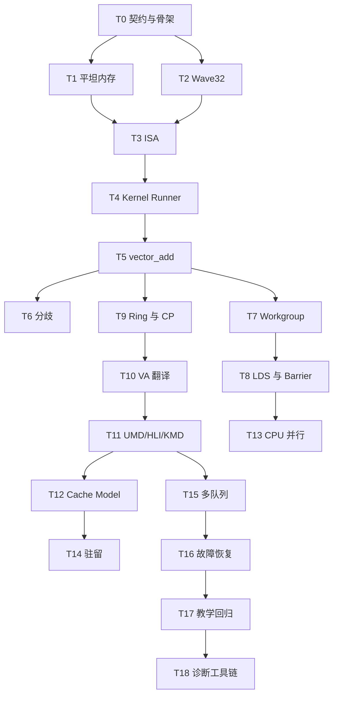

# CPU 模拟 GPU 教学项目：任务规划与实施规格

> 文档性质：项目级任务规划与验收规格。定义项目目标、实现任务、依赖、场景和交付物。权威关系遵循 `docs/roadmap.md` → `docs/architecture-design.md` → `docs/design/` → 本文的实施拆解；本文补充教学顺序和交付呈现，不改写上游冻结的章号、场景号、接口契约与能力范围。
>
> 项目定位：在 CPU 上实现可追踪、可测试的 GPU 全栈软模型，以图形 draw 链路作为初级可视化主线，以计算 dispatch 作为高级共用执行单元与驱动扩展线，学习 GPU 执行模型、命令提交、内存层次、同步及图形/计算软件栈。它不是周期精确仿真器，不追求厂商 API/二进制兼容，也不承诺模拟特定 GPU 的全部细节。
>
> 总原则：先建立契约和最短可验证的模块基线，再按既有初级图形链路完成 E0–E5 首帧；随后逐步补齐高级硬件行为、图形 UMD，并在共用底座稳定后推进计算管线与计算驱动。每个阶段都有运行场景和明确 DoD；扩展功能不得阻塞前序教学闭环。

---

## 1. 项目目标与设计原则

### 1.1 项目回答的问题

项目以 CPU 实现 GPU 的功能行为，最终覆盖两条纵向路径：图形 draw 从应用/图形 UMD 经过 HLI、KMD、FW、CP 到达硬件单元，经过可编程 shader 与固定功能阶段后写入 RT 并显示；计算 dispatch 从计算驱动或 HLI 入口经共用提交/内存/执行单元，按 workgroup/wave 执行并写回内存。初级先完成简化图形链路，高级逐章替换硬件模型并追加计算驱动线。

最小代码正确性基线可以用单 wave `vector_add` 验证 ISA、wave 和内存；首个面向学习者展示的端到端成果应按既有 E0–E5 场景完成一帧绘制（清屏、三角形、纹理四边形、网格和合成帧）。高级阶段再依次扩展 E→S 图形能力，并在第 37 章收口计算管线、stage3 第 38–42 章完成计算驱动入口。

### 1.2 明确边界

| 项目内 | 当前不做 |
|---|---|
| CPU 上的功能行为模型、确定性执行、可解释 trace | 周期精确、功耗、时钟、真实流水线每拍变化 |
| 简化的 GPU 地址空间、显式 L1/L2 cache model | 把宿主 CPU 的 L1/L2 直接当作被模拟的 GPU cache |
| 一种自定义精简 ISA 与手写/内置 kernel | 兼容 CUDA、HIP、MUSA 或完整 Vulkan/D3D12 API |
| 单进程 CPU worker 并行执行模拟 workgroup | 模拟真实 GPU 的硬件带宽、吞吐或占用率数值 |
| 可复现的功能测试和统计探针 | 以模拟器性能数据推断真实 GPU 性能 |

宿主 CPU 的 L1/L2/L3 只影响模拟器自身运行速度。模拟 GPU 的缓存/片上暂存由软件显式建模，重点定义它位于数据通路中的位置、承担的数据复用或暂存职责、数据生命周期、写入/排空/失效及可见性规则。容量、行宽和替换策略是实现这些语义所需的模型参数；hit/miss 可作为内部诊断信息，不作为本项目主要教学目标或性能结论。GS/Tessellation 的 patch/control point 与生成数据可用于讲解跨阶段数据暂存和复用，但不得把这些缓冲一概等同于 L1/L2 cache。

### 1.3 教学设计原则

1. **端到端优先**：先完成一条最短可运行路径，不先实现所有模块的空壳。
2. **概念一次引入一个**：每个任务或展示单元解决一个主要新概念，避免把调度、页表、缓存、异步和 API 兼容塞进同一任务。
3. **逐步替换简化模型**：早期采用 flat memory、单 wave、同步执行；后续明确替换点，不隐藏简化假设。
4. **模型与实现分开**：GPU 概念模型由显式状态和事件实现；CPU worker 只是模型执行策略。
5. **确定性优先**：功能结果不依赖线程调度、墙钟时间或未定义竞争顺序。
6. **每个任务有可运行验收**：DoD 包含输入、输出、断言或可检查 trace，不以“代码已写”作为完成标准。

---

## 2. 总体架构与数据通路

### 2.1 分层架构与职责

后续代码目录、模块职责和依赖方向以 [architecture-design.md](architecture-design.md) 的模块树为准；本文负责安排实现任务的先后、验收场景和 DoD。架构文档规定初级图形阶段经薄提交门面完成 E0–E5；高级图形 API 通过 HLI/UMD 接入，计算管线在第 37 章收口、计算驱动在第 38–42 章实现。T0–T5 的 vector_add 仅为早期 ISA/wave/内存功能验证，不改变图形优先的产品演进顺序。

| 层 | 规范模块 | 职责与边界 |
|---|---|---|
| 公共契约 | `common/` | 跨层共享的类型、错误、命令 packet、ISA/ABI、格式、日志和配置；不承载设备执行逻辑 |
| 硬件行为模型 | `hw_sim/` | 模拟设备、MMIO、ring、CP、中断/fence、内存层次、shader/wave、ISA、纹理与图形固定功能；不得依赖 UMD/KMD |
| 固件模型 | `firmware/` | 模拟启动、命令队列调度和 watchdog；通过明确的寄存器/队列协议与硬件模型交互 |
| 内核驱动模型 | `kmd/` | 模拟设备初始化、内存映射、上下文、提交、调度、中断和 reset；不直接执行 shader 指令 |
| 硬件无关层 | `hli/` | 统一 Device/Queue/Resource/View/Descriptor/Pipeline/Command/Capability 对象，隔离上层 API 与 KMD |
| 用户态驱动 | `umd/` | `graphics/api` 与 `graphics/pal` 负责图形 API/PAL；`compute` 提供计算 context/module/function/stream/event；`shader` 放前端、IR、优化、寄存器分配和代码生成；`os` 封装 host 内存、线程、时间与隔离 |
| 应用与场景 | `apps/`、`tests/scenes/` | apps 通过当前阶段公开的 facade 或 UMD 接口使用设备；测试场景验证跨层行为，不绕过契约访问内部状态 |
| 工具与测试 | `tools/`、`tests/` | 工具消费稳定导出格式；contract/unit/scenes/golden 分别验证边界、模块、集成场景和固定结果 |

依赖方向遵循单向层次：

`common → hw_sim → firmware → kmd → hli → umd → apps`

各层可以依赖 `common`；`tools` 和 `tests` 可依赖公开接口及稳定导出格式。禁止反向依赖：例如 `hw_sim` 不引用 `kmd`、`hli` 或 `umd`。编译器/ISA 的连接通过 `common/isa` 与 `common/shader_abi` 等稳定契约完成。不得新增平行的根级 `runtime/`、`driver/`、`gpu_model/` 或 `isa/` 目录。

### 2.2 仓库模块树

以下目录以 architecture-design.md §2.4/§5 为规范。项目按任务逐步填充，不要求首期实现整棵树；不在当前任务范围的模块保留为空缺，不建立无职责空壳。

```text
common/
  types/ result/ packet/ isa/ shader_abi/ format/ log/ config/
hw_sim/
  submit/
  core/ device/ mmio/ ring/ cp/ interrupt/ fence/
  memory/ flat/ translation/ heaps/ cache/ residency/
  periph/ copy/ display/
  shader/ wave/ divergence/ scheduler/ subgroup/ shared/
  isa/ texture/
  frontend/ ia/ vgt_spi/ clip_pa/
  raster/ rasterizer/ msaa/
  om/ visibility/ geometry/ query/ se/
firmware/ boot/ scheduler/ watchdog/
kmd/ ddi/ init/ memory/ context/ submission/ scheduler/ interrupt/ reset/
hli/ device/ queue/ resource/ view/ descriptor/ pipeline/ command/ capability/
umd/
  graphics/ api/ vulkan/ d3d12/ gl/
            pal/ resource/ binding/ pipeline/ cmd_gen/ queue/
  shader/ frontend/ ir/ opt/ regalloc/ emit/ llvm/
  compute/ context/ module/ function/ stream/ event/
  os/ host_memory/ threads/ time_source/ isolation/
apps/ scene_e0..scene_e5/ scene_s0..scene_s19/
tools/ isa_asm/ isa_disasm/ ref_model/ image_diff/ pick_probe/
       scene_snapshot/ spec_runner/ log_analyze/ mem_audit/ state_inspector/
tests/ contract/ unit/ scenes/ golden/
```

当前计算教学主线实际落位：`common` → `hw_sim/memory/flat`、`hw_sim/shader/wave`、`hw_sim/isa` → `hw_sim/submit`、`hw_sim/core/ring`、`hw_sim/core/cp` → `firmware` → `kmd` → `hli` → `umd/compute` → `apps`。架构文档定义的首期图形 facade（`hw_sim/submit/facade.h`，`submit(draw_desc)/wait()`）适用于图形 Stage 1；本项目的计算主线在 T0–T5 使用 `tests/scenes` 中的内部模型级 harness 验证 ISA 与 wave，不把它伪装成完整 UMD/API 路径。T11 再建立真实的 compute UMD→HLI→KMD→Firmware→CP 提交链。

### 2.3 任务到模块的落位

| 任务 | 主要目录 | 说明 |
|---|---|---|
| T0 | `common/{types,result,log,config}`、构建配置、`tests/unit` | 冻结公共类型、日志、错误和配置契约 |
| T1 | `hw_sim/memory/flat`、`hli/resource`（后续）、`tests/unit` | 先实现模型内平坦显存，再由 HLI 资源对象封装 |
| T2 | `hw_sim/shader/wave`、`common/types` | wave/lane/寄存器状态 |
| T3 | `common/isa`、`hw_sim/isa`、`tools/isa_asm`、`tools/isa_disasm` | ISA 公共定义、执行与工具分层 |
| T4 | `tests/scenes` 的模型级 harness，执行逻辑位于 `hw_sim/shader` 与 `hw_sim/isa` | harness 仅用于早期验证，不形成新的 runtime 层 |
| T5 | `tests/scenes`、`tools/ref_model`、`hw_sim` | vector_add 首期闭环；此时不宣称已贯通 UMD/KMD |
| T6–T8 | `hw_sim/shader`、`hw_sim/memory`、`tests/scenes` | SIMT 分歧、workgroup、共享内存与同步 |
| T9 | `hw_sim/submit`、`hw_sim/core/{ring,cp,interrupt,fence}`、`firmware` | 命令提交与完成通知 |
| T10 | `hw_sim/memory/{translation,heaps,residency}`、`kmd/memory` | VA 映射和驻留策略，模型与驱动职责分开 |
| T11 | `umd/compute`、`hli`、`kmd`、`firmware`、`hw_sim/submit` | 建立完整公开计算提交链与对象生命周期 |
| T12 | `hw_sim/memory/cache` | 显式模拟 L1/L2，不读取宿主 CPU cache 作为 GPU cache 状态 |
| T13–T14 | `hw_sim/shader/scheduler`、`umd/os/threads`、`tests` | 逻辑调度与 CPU worker 执行策略分离 |
| T15–T16 | `umd/compute`、`hli/queue`、`kmd/scheduler`、`firmware/scheduler` | stream/event、依赖、故障与恢复 |
| T17–T18 | `tests/{contract,unit,scenes,golden}`、`tools` | 场景规格、回归、诊断导出和分析 |

### 2.4 核心计算数据通路


这条完整路径对应 T11 及之后的驱动闭环。T0–T5 的模型级 harness 只用于先验证 wave、ISA 和内存的功能语义；T9–T11 逐层引入提交协议与对象边界。驱动不得直接调用执行单元，命令必须经 ring/doorbell/CP 进入模型；`hw_sim` 不识别应用 API、UMD 或 KMD 对象。

## 3. 阶段总览

项目有两种互补的组织视角：T0–T18 是较细的概念与基础模块任务；正式产品演进按 `roadmap.md` 的图形优先阶段推进，再追加计算管线与计算驱动。T5 的 vector_add 只作为 ISA/wave/内存的微型功能基线，不代替初级图形端到端场景 E5。

| 正式产品阶段 | 章与工作包 | 学习/交付结果 | 阶段出口 |
|---|---|---|---|
| 初级图形闭环 | 第 1–9 章，WP0–WP1 | 从薄提交门面到首帧图形，包含 VS 与固定功能阶段 | E0–E5 全绿，重复运行图像逐字节一致 |
| 高级底座与执行 | 第 10–19 章，WP2–WP3 | KMD/FW、地址/内存、缓存/驻留、调度、ISA 与编译器 | A、B 门禁通过，初级场景不退化 |
| 高级图形流水线 | 第 20–28 章，WP4 | 资源绑定、纹理、几何前端、GS/Tess、光栅和 OM 扩展 | C 门禁通过，S3–S9/S14 达到判据 |
| 并行与系统 | 第 29–36 章，WP5–WP6 | SIMT 协作、并行、队列、多引擎、图形 UMD 与恢复机制 | D、E 门禁通过，策略与 API 后端回归一致 |
| 计算管线 | 第 37 章，WP7 | 直连 HLI 的计算 dispatch 与共用语义收口 | F 门禁通过，S18/S19 通过 |
| 计算驱动 | 第 38–42 章，WP8 | context/module/function/stream/event、launch 与双入口 | G 门禁通过，A38–A42 全绿 |

T0–T18 的任务顺序用于分步学习和实现基础机制；若与正式章号、场景号或阶段门禁的顺序发生冲突，以 `roadmap.md` 为准。模块/章节体量用 S/M/L 表示；L 级任务必须按 roadmap 已登记的子里程碑拆开验收。

### 3.1 两条纵向主线与共用模块

| 主线 | 学习者看到的输入与结果 | 主模块 | 主要验收 |
|---|---|---|---|
| 图形线 | 顶点/索引/状态 → draw → 可编程着色阶段与固定功能阶段 → RT/显示帧 | `hw_sim/frontend`、`shader`、`raster`、`om`、`visibility`、`periph/display`，以及图形 HLI/UMD | 初级 E0–E5 全图逐字节；高级 S0–S17 探针与差分 |
| 计算线 | kernel/module/function/参数 → dispatch(grid, block) → workgroup/wave → 内存写回与同步 | `umd/compute`、`hli`、`kmd`、`firmware`、`hw_sim/shader`、`memory`、`isa` | S18/S19；阶段 F 直连 HLI；stage3 A38–A42 双入口等价 |
| 共用底座 | 两条线共享命令、地址空间、资源、缓存、队列、同步、错误和调度 | `common`、`hw_sim/core`、`hw_sim/memory`、`firmware`、`kmd`、`hli` | 共用模块无 graphics-only/compute-only 特化；E/S 回归不退化 |

图形与计算的主要差异保留在入口和工作负载上：图形由可编程着色阶段与固定功能单元共同组成，涵盖 IA、裁剪/图元装配、光栅、深度/模板/混合及输出；GS/Tessellation 是高级几何扩展，不是第一帧的前置条件。计算没有 IA/光栅/OM，以 grid/block、workgroup/wave、内存作用域和 barrier 为核心。内存、命令派发、执行阵列、ISA、队列及同步应复用同一模块语义。

### 3.2 完整功能工作包与阶段验收

下列工作包按正式路线排序，与 `roadmap.md` 的门禁一致。工作包是对章节成果的聚合说明；正式任务仍使用 roadmap 的章号、子里程碑和 E/S/A 场景编号。

| 工作包 | 对应正式章节 | 需要完成的功能与可学习内容 | 关键交付/门禁 |
|---|---|---|---|
| WP0：公共契约 | 1 | 类型/错误/packet/ISA ABI/日志/配置；地址、像素格式、浮点和确定性约定 | E0；契约与汇编往返自检 |
| WP1：初级图形闭环 | 2–9 | 薄提交门面、单环/CP、flat VA/bump、warp32 单波、最小 ISA；IA→VS→裁剪/视口/PA→光栅→OM；nearest 纹理、清屏、双缓冲和帧导出。VS 是可编程着色阶段；IA/裁剪/PA/光栅/OM 是本教学模型中的固定功能单元 | E1–E5；一帧包含渐变三角、贴图四边形和简单网格，输出逐字节一致 |
| WP2：高级设备、内存与上下文底座 | 10–14 | 设备/MMIO、ring wrap/CP/fence/中断、FW/KMD 边界；HostVa/GpuVAddr/PhysAddr、页表/TLB、VRAM/GART/System 堆、分配和内存池；L1/L2 与写缓冲的功能职责、flush/可见性；Copy/Display、residency、ASID/context | A 门禁：S1/S2/S13；E0–E5 不退化 |
| WP3：执行、ISA 与编译器 | 15–19 | 分歧和重收敛、波调度；完整 ISA/汇编器；GLSL-like 前端、AST/SSA/CFG、类型/IO 检查、优化、寄存器分配与发射、LLVM 对照 | B 门禁：S0/S3；ISA/ABI 冻结，执行及编译路径满足场景判据 |
| WP4：资源、纹理与图形管线扩展 | 20–28 | 资源/视图、描述符、绑定、管线和状态快照；纹理格式、布局、mip/LOD、过滤、数组/Cubemap；IA 索引/重启/实例化、VS 切片、裁剪/PA；光栅插值/点线/scissor；depth/stencil/blend/MRT/LoadOp/StoreOp；MSAA/可见性；Tess/GS patch 几何扩展 | C 门禁：S3–S9/S14；Tess/GS 作为高级独立场景，不是 E5 首帧前置项 |
| WP5：SIMT 协作与硬件对齐并行 | 29–31 | ballot/shuffle/reduction/导数；LDS/shared、atomic、barrier、内存序/作用域；grid/block→workgroup/wave/lane 映射；SE/CU、occupancy 上限和策略 A/B | D 门禁：S10/S11；S18/S19 所需共用计算语义具备，串行/并行硬判据一致 |
| WP6：队列、多引擎、查询与驱动后端 | 32–36 | Graphics/Compute/Copy 队列、fence/semaphore、所有权转移；IB、间接命令、predication、DMA；query/statistics；HLI、Vulkan/D3D12/OpenGL 图形 UMD 子集；分层错误与按引擎复位 | E 门禁：S12/S13/S15–S17；重点验收 API→HLI→KMD→FW→硬件提交和资源/队列协同 |
| WP7：计算管线收口 | 37 | KernelArgsLayout 校验、Compute 派发、uniform 装载、三维 workgroup 映射、组内同步、异步/间接 dispatch、query/UAV；经直连 HLI 执行计算场景 | F 门禁：S18/S19；计算功能与共用底座通过双执行策略验证 |
| WP8：计算驱动与双入口 | 38–42 | 计算 UMD 对象模型 context/module/function/stream/event；module 装载、参数打包和 LaunchKernel；异步 stream/event；协作、间接 dispatch/UAV；直连 HLI 与计算驱动双入口 | G 门禁：A38–A42；S18/S19 双入口逐值等价，完整 E/S 回归 |

WP4 中的 Tessellation/GS 会增加专门的 patch/control point 与生成数据流演示，帮助解释几何阶段间的数据暂存和复用。具体 cache、patch buffer、顶点流缓冲分别归属各自模块；不能把“所有阶段数据复用”都说成 L1/L2 命中。

任务拆分执行正式来源为 `roadmap.md` §2.1–§2.4。10、11、14、17、18、20、21、25、26、28、30、31、35 等 L 级章节必须按 roadmap 已登记的子里程碑分别设计、实现、验收；跨章节接口先冻结再集成，不以“一次性完成整章”作为任务粒度。


## 4. 任务规格

每项任务均按“目标—范围—依赖—实施项—交付物—DoD”验收。实现过程中新增功能若改变公开契约，必须同步更新接口文档、场景输入和回归判据。

### 阶段 A：最小计算闭环

#### T0：工程骨架与统一契约（S）

- **目标**：建立可编译、可测试、可配置的最小工程，并冻结跨模块基础类型。
- **范围**：构建、基础日志、错误返回、断言、设备配置、统一整数宽度；暂不建立完整驱动对象。日志和断言从首个模块建立统一规则，后续观测工具逐步扩展。
- **依赖**：无。
- **实施项**：
  1. 按模块树建立 `common`、`hw_sim`、`firmware`、`kmd`、`hli`、`umd`、`apps`、`tools`、`tests` 的最小目录与依赖规则；只创建当前任务需要的目录。
  2. 定义 `Result/ErrorCode`、`GpuVa`、`DeviceConfig`、日志级别和确定性随机种子。
  3. 提供命令行入口，支持选择场景、配置和 trace 开关。
  4. 建立 Error/Warn/Info/Debug/Trace 分级日志接口，记录 level、module、submodule 和键值字段；支持 console 与模块文件 sink。
  5. 定义 static_assert、DEV_ASSERT 和硬件行为校验三类断言；硬件违例通过 Result 上报，不能依赖原生 assert 直接终止进程。
  6. 定义日志开销规则：逐 lane、逐指令、逐像素等热点循环默认不输出 Debug/Trace；Debug/Trace 可在 Release 构建中裁剪。
- **交付物**：可构建骨架、契约头文件、分级日志接口和 sink、断言约定、最小自检场景、架构依赖说明。
- **DoD**：干净构建成功；自检验证基础类型和配置；错误码输出稳定；日志等级过滤、模块字段与 sink 路由有单测；硬件错误在 Release/Debug 均转成 Result，不因原生 assert 崩溃；场景可重复运行。

#### T1：GPU 平坦内存与资源 API（M）

- **目标**：让 kernel 能通过 GPU 虚拟地址访问一块可追踪的模拟显存。
- **范围**：单一连续 GPU VA 空间、平坦字节数组、线性分配；无页表、无缓存。
- **依赖**：T0。
- **实施项**：
  1. 实现 GPU 内存分配/释放、边界检查、对齐策略。
  2. 实现 Host→GPU 上传、GPU→Host 读回和明确的资源生命周期。
  3. 提供 load/store 接口，统一记录地址、长度和访问来源。
- **交付物**：`GpuMemory`、`Buffer` 最小接口、越界和生命周期场景。
- **DoD**：上传后可读回；非法地址和越界访问返回确定错误；分配释放后审计无泄漏；访问 trace 显示 VA/长度/读写类型。

#### T2：Wave32 执行状态（M）

- **目标**：在 CPU 数据结构中表达 GPU 的一个 wave 与 32 个逻辑 lane。
- **范围**：wave32、lane 活跃掩码、标量/向量寄存器；先不处理分歧控制流。
- **依赖**：T0。
- **实施项**：
  1. 定义 wave、lane、SGPR/VGPR、PC、执行掩码等状态。
  2. 定义 lane id、work-item linear id 等内建值的来源与边界规则。
  3. 提供状态 dump，能查看每条指令前后的 PC、mask 和寄存器。
- **交付物**：Wave 状态模型、寄存器访问接口、状态 dump 示例。
- **DoD**：32 lane 的 mask 操作符合真值表；未激活 lane 不产生副作用；状态快照可稳定序列化。

#### T3：精简 ISA 与解释器（M）

- **目标**：用少量明确的指令实现可逐步调试的计算 kernel。
- **范围**：整数/浮点加法、乘法、比较、地址计算、load/store、分支、结束；不追求厂商 ISA 兼容。
- **依赖**：T1、T2。
- **实施项**：
  1. 设计指令语义表及定长或明确变长编码。
  2. 实现 decode、执行、PC 更新、访存异常传播。
  3. 提供手写汇编/字节码装载方式及反汇编输出。
  4. 定义浮点精度与异常处理策略，避免测试依赖未定义行为。
- **交付物**：ISA 规格、解释器、指令单测、最小汇编样例。
- **DoD**：每条指令有独立语义测试；编码/解码往返一致；trace 能解释每步输入、结果和副作用；非法 opcode 有明确错误。

#### T4：单 wave kernel 运行器（M）

- **目标**：把 kernel 镜像、参数、wave 状态和内存模型连接起来。
- **范围**：一个 kernel、一 wave、同步执行；通过 CPU 循环解释指令。
- **依赖**：T1–T3。
- **实施项**：
  1. 定义 kernel descriptor、参数布局和入口 PC。
  2. 初始化 wave 内建值和参数寄存器。
  3. 运行到 END、错误或指令步数上限；支持单步和连续模式。
- **交付物**：`KernelRunner`、kernel 参数 ABI、step/run 接口。
- **DoD**：至少一个逐 lane 计算 kernel 可运行；步数上限能终止死循环；单步与连续运行的最终状态相同。

#### T5：vector_add 模型级功能基线（L，拆为 3 个子里程碑）

- **目标**：完成一条模型级 kernel 到 GPU 内存写回的可观察路径，为 ISA、wave、内存模块提供功能基线；该场景不是产品首个图形端到端演示。
- **范围**：N≤32 的单 wave vector_add；不要求 ring、编译器或并发 workgroup。
- **依赖**：T0–T4。
- **子里程碑**：
  - **T5.1**：场景 harness 准备输入/输出 buffer 和 kernel 参数。
  - **T5.2**：测试 harness 调用 `KernelRunner` 的同步接口，构造最简 kernel descriptor；该入口只服务早期模型验证。
  - **T5.3**：运行器执行 kernel，读回结果并与 CPU reference 比对。
- **交付物**：`tests/scenes/scene_vector_add`、CPU reference、运行日志、模型级执行路径说明。
- **DoD**：正常、空输入、非法参数和越界 case 均有判据；CPU reference 独立计算期望结果；重复运行输出一致。

### 阶段 B：SIMT 与 workgroup 协作

#### T6：控制流分歧与重收敛（M）

- **目标**：展示同一 wave 内 lane 执行不同分支时的 SIMT 语义。
- **范围**：条件分支、活动 mask 保存/恢复、结构化分支或明确的分歧栈方案。
- **依赖**：T5。
- **实施项**：定义分支语义；实现分歧/重收敛状态；记录 lane mask 变化；增加不同 lane 走不同路径的场景。
- **交付物**：分歧模型、branch kernel、逐步 trace。
- **DoD**：全真、全假、混合 mask 三类输入正确；无效 lane 不写内存；分支完成后活跃 lane 正确重收敛。

#### T7：多 wave / workgroup 与逻辑调度（L）

- **目标**：区分 work-item、wave、workgroup 与 CPU 执行线程。
- **范围**：多 wave 同步语义下的确定性串行调度；暂不以宿主线程代表 GPU wave。
- **依赖**：T5、T6。
- **实施项**：
  1. 定义 grid/block/workgroup 三维 ID、越界规则和线性化公式。
  2. 将 workgroup 拆分为若干 wave，并管理每个 wave 的寄存器和完成态。
  3. 提供可替换调度策略接口，初版 round-robin 串行执行。
- **交付物**：workgroup 模型、调度器、grid-stride 示例。
- **DoD**：多个 workgroup 的 ID/边界覆盖正确；调度顺序固定；改变调度顺序不改变无竞争 kernel 的结果。

#### T8：LDS、原子与 workgroup barrier（L）

- **目标**：建模 workgroup 内共享内存和跨 wave 协作的功能语义。
- **范围**：显式 LDS 数组、基本整数原子、workgroup barrier；不模拟真实 bank 冲突周期。
- **依赖**：T7。
- **实施项**：
  1. 定义 LDS 生命周期、地址范围和每 workgroup 隔离。
  2. 定义原子操作的线性化点与返回值。
  3. barrier 采用参与 wave 到齐后统一放行的逻辑事件；检测提前退出或不一致 barrier。
  4. 实现 reduction 或 histogram 场景。
- **交付物**：LDS/atomic/barrier 模块、协作 kernel、同步错误场景。
- **DoD**：共享数据结果正确；原子计数满足精确期望；barrier 不完整时报告可定位错误，不死锁挂起。

### 阶段 C：驱动提交与地址空间

#### T9：命令包、Ring 与 Command Processor（L）

- **目标**：用可观测的命令提交路径逐步替代测试 harness 对 KernelRunner 的直接调用。
- **范围**：单进程、单队列、CPU 同步推进的 Ring 模型；不模拟 MMIO 时序与中断延迟。
- **依赖**：T5；建议 T7 稳定后扩展 dispatch。
- **实施项**：
  1. 定义 packet header、opcode、长度、校验及版本规则。
  2. 实现 producer/consumer 指针、doorbell 事件与 Ring 回绕检查。
  3. Command Processor 解包并派发 CLEAR/COPY/DISPATCH/FENCE 等最小命令。
  4. 保留 direct-launch 对照入口，便于学习新旧路径差别。
- **交付物**：命令 ABI、Ring、CP、命令 trace。
- **DoD**：命令序列和执行效果可重放；非法包、Ring 满/空和截断包有稳定错误；通过 Ring 的 vector_add 与直连入口结果一致。

#### T10：Context、内存对象与 VA 翻译（M）

- **目标**：从平坦地址模型过渡到进程/上下文隔离的 GPU VA 模型。
- **范围**：软件页表 + TLB 功能模型；页大小固定；不模拟真实页表 walker 时延。
- **依赖**：T1、T9。
- **实施项**：创建 Context/ASID；映射、解除映射和权限检查；实现 VA→PA 翻译与可选 TLB 命中统计；定义未映射访问错误。
- **交付物**：地址空间管理器、页表/TLB 统计、隔离场景。
- **DoD**：不同 Context 的同 VA 指向不同数据；读写权限生效；TLB 开关不改变功能结果；失效后重新翻译正确。

#### T11：UMD / HLI / KMD 对象边界与错误传播（M）

- **目标**：把场景代码从内部模型细节中解耦，形成教学所需的最小软件栈。
- **范围**：Device、Context、Buffer、Kernel、Queue、Submission 对象及错误映射；不做外部 API 兼容。
- **依赖**：T9、T10。
- **实施项**：明确 compute UMD、HLI、KMD 对象生命周期；UMD/HLI 验证上层参数与对象状态，KMD 验证提交和映射；定义各层错误到 GPU 执行错误的传播规则；禁止上层直接访问 hw_sim 私有状态。
- **交付物**：API/ABI 文档、对象模型、错误映射表、经抽象层运行的场景。
- **DoD**：核心计算场景可经 UMD compute→HLI→KMD→Firmware→Ring/CP 路径执行；对象释放、重复提交和非法状态均有确定行为；层间依赖检查通过。

### 阶段 D：内存层次与 CPU 并行模拟

#### T12：显式 GPU 缓存与片上数据暂存模型（L）

- **目标**：解释 GPU 工作流中缓存和片上暂存如何连接生产者/消费者、缩短数据往返并支持阶段间复用。
- **范围**：以 `hw_sim/memory/cache` 的 L1/L2 与写缓冲为共用缓存模型；必要的顶点、patch、控制点或生成数据缓冲属于相应单元的局部暂存/输出队列。两者职责分开建模，不模拟周期或真实吞吐，也不把命中率作为核心教学目标。
- **依赖**：T10、T11；需与 `docs/design/memory-system.md`、纹理/几何单元契约一致。
- **实施项**：
  1. 定义缓存与局部暂存分别位于哪条数据通路、由哪个模块拥有、数据何时产生/消费/释放。
  2. 为缓存定义开关、基本容量/行宽/关联度和写策略，使缓存读写、flush/invalidate 及 Host/GPU 可见性行为确定。
  3. 为 GS/Tessellation 场景说明 patch/control point 输入、tess factor、生成顶点/图元的存储与复用边界；不假定所有中间数据都驻留于 L1/L2。
  4. 输出可读的数据流/生命周期记录，以及必要的模型正确性统计；hit/miss 等细节最多作为可选诊断，不用于主要场景判据或性能推断。
  5. 以重复顶点/patch 和跨阶段消费者场景验证复用语义；以同步/失效场景验证可见性。
- **交付物**：缓存/暂存职责图、可配置的 GPU cache model、GS/Tess 中间数据缓冲语义、数据流 trace 样例和可复现验证场景。
- **DoD**：缓存开关不改变功能结果；小规模输入可解释数据在哪个单元被保留、何时被复用/排空；flush/invalidate 边界正确；场景不依赖 hit/miss 比例或 CPU cache 统计。

#### T13：CPU Worker Pool 与确定性执行策略（L）

- **目标**：利用宿主 CPU 多核提高模型执行速度，同时保持模拟语义与并行度可控。
- **范围**：以 workgroup 为任务粒度的 worker pool；同一 workgroup 内 barrier 语义由模型调度器处理；不以宿主硬件缓存模拟 GPU cache。
- **依赖**：T7、T8、T11；缓存模块稳定后做集成回归。
- **实施项**：
  1. 将执行模式分为 GPU 模型调度器和 CPU host worker 两层：前者决定 wave/workgroup 的逻辑状态转换，后者只决定由哪个 OS 线程执行模拟任务。
  2. 实现 serial 与 parallel 两种执行模式；任务粒度以 workgroup 或互不依赖的 tile 为主，不为每个 lane 创建 OS 线程。
  3. 定义 WorkerPool 生命周期、队列容量、任务切分、停止/取消、异常转 Result、worker 数配置和等待策略；避免嵌套线程池导致过度订阅。
  4. 同一 workgroup 的 LDS、barrier 和 wave 状态由协作式模型调度器管理；不能让 OS worker 阻塞在 barrier 上造成线程池饥饿。
  5. 独立 workgroup 可并行；全局原子只保证已声明语义；存在数据竞争或未定义次序时检测并拒绝或标记为非确定场景。
  6. 线程本地计数器局部累积后归并；事件按逻辑序号和对象 ID 规范化，避免并行完成顺序污染可复现报告。
  7. 使用连续数据分区和有界任务粒度改善 host cache locality；热点统计量避免伪共享。这些优化不得改变被模拟 GPU cache 行为。
  8. 记录 host wall time、CPU time、worker 数、任务数和任务粒度；host 性能测试与 GPU 模型正确性门禁分离。
- **交付物**：逻辑调度器/WorkerPool 接口、执行模式配置、并行一致性与竞争场景、host 性能基准。
- **DoD**：serial/parallel 对无竞争硬门禁场景结果一致；worker 数为 1 与 serial 语义一致；功能判据不依赖线程完成顺序；stress 场景通过 ThreadSanitizer 或等价竞争检查（若工具链支持）；host cache 优化与 GPU cache 统计分开报告。

#### T14：驻留、资源预算与可观测性（M）

- **目标**：用简化模型展示显存预算、资源驻留和内存压力。
- **范围**：显式 resident/non-resident 状态、固定预算、确定性逐出策略；不实现复杂共享虚拟内存或真实缺页恢复。
- **依赖**：T10、T12。
- **实施项**：资源驻留/退出；超预算处理；访问非驻留资源时的错误或受控恢复策略；输出 residency、VA 翻译和资源生命周期/跨单元数据流的关联记录。
- **交付物**：Residency Manager、资源压力场景、内存事件 trace。
- **DoD**：预算内访问成功；超预算按配置给出稳定结果；逐出和重新驻留有明确数据正确性规则；记录可关联资源 ID、VA、驻留状态和数据消费者；不以缓存 hit/miss 作为门槛。

### 阶段 E：异步系统、工具链与教学收尾

#### T15：多队列、Fence/Event 与依赖图（L）

- **目标**：展示异步提交及跨队列依赖，而不引入墙钟驱动的模拟行为。
- **范围**：Compute/Copy 两种逻辑队列、逻辑时间线 fence、event wait；同步推进的确定性事件循环优先。
- **依赖**：T9、T11。
- **实施项**：队列提交序号；signal/wait；资源跨队列使用依赖；可选 copy 与 compute 交错；死锁/循环依赖检测。
- **交付物**：多队列事件调度器、依赖 trace、async copy + kernel 场景。
- **DoD**：依赖未满足时消费者不执行；signal 前不得观察到写入完成；改变无依赖命令的队列顺序不破坏结果；循环依赖可诊断。

#### T16：故障注入、超时与可恢复性（M）

- **目标**：让学习者观察执行错误如何跨 hw_sim、CP、KMD/HLI 与 UMD 传播。
- **范围**：非法指令、非法地址、Ring 错误、执行步数超限等软件可控故障；不模拟真实硬件故障概率。
- **依赖**：T9–T11、T15。
- **实施项**：故障注入开关；错误定位和责任层；Context/Queue 失效状态；简单 reset/recreate；保留失败现场快照。
- **交付物**：错误场景集、错误传播表、故障快照。
- **DoD**：故障能被对应层捕获并映射；失败队列不误报成功；复位后新任务可运行；诊断信息包含场景、命令、PC/VA 等有效上下文。

#### T17：教学场景、回归套件与扩展入口（M）

- **目标**：把模块实现组织成循序渐进的实验，而非堆叠孤立功能。
- **范围**：E/S/C 基础场景必须 headless 可运行；图形 API 子集与 MUSA 风格计算对象模型按 roadmap 对应阶段实施；API/二进制兼容明确不做。
- **依赖**：T0–T16 中纳入一期的任务；T18 使用本任务定义的场景与回归规则。
- **实施项**：
  1. 为每个概念提供一个最小 scene、预期结果、关键 trace 说明和常见错误。
  2. 建立自动场景 runner、CPU reference、差分输出和回归汇总。
  3. 文档列出模块目标、输入输出、依赖、算法简化、DoD、扩展点。
  4. 提供学习路径：先运行、再单步、再修改参数/实现、最后比较统计。
- **交付物**：场景目录、教学说明、回归报告、扩展路线图。
- **DoD**：核心场景一条命令可运行；新手可从 E0/E1 起步，完成 E5 图形闭环，再按阶段学习内存、SIMT、驱动和计算场景；vector_add 作为早期 ISA/wave 正确性练习；每个场景失败都产生足够诊断材料；未实现能力明确报告“不支持”。

#### T18：日志分析与诊断工具链（L）

- **目标**：让教学场景可复现、失败原因可定位、模拟器状态可离线检查。
- **范围**：消费文本日志、raw 输出、场景 JSON 快照、内存 dump 和模型统计；工具不读取 GPU 模型私有头文件，也不修改模拟结果。
- **依赖**：T0、T10、T12、T16、T17。
- **实施项**：
  1. scene_snapshot 保存场景 ID、输入引用、配置、执行模式、seed、构建版本和参数，并支持快照复跑。
  2. log_analyze 提供 Error/Warn 计数、模块过滤、重复告警聚合和首发错误定位。
  3. mem_audit 从公开内存快照检查分配/释放配对、use-after-free 标记和资源预算；能力边界与现有数据源一致。
  4. state_inspector 读取公开状态与计数器导出，展示 queue/fence、workgroup/wave、VA/TLB/cache 摘要。
  5. failure_bundle 在校验失败时收集配置、可复现输入、错误摘要、期望/实际差异和必要日志；大型产物作为临时 CI artifact，不默认入库。
  6. 为工具和导出格式提供版本号，变更时保持兼容或更新版本。
- **交付物**：scene_snapshot、log_analyze、mem_audit、state_inspector、失败制品打包脚本和使用说明。
- **DoD**：快照可在另一工作目录复现同一功能失败；日志分析有固定样例验证；工具只消费公开导出格式；失败制品完整、无无关大文件；headless 环境可运行诊断命令。

---

## 5. 任务依赖与推荐实施顺序

### 5.1 主依赖



### 5.2 建议顺序

1. 串行完成 T0–T5，确保最小计算闭环尽早可用。
2. 完成 T6–T8，先建立正确的 SIMT/workgroup 语义，再引入 CPU 并行。
3. 实施 T9–T11，把直连 runner 逐步升级为教学版驱动提交链路。
4. 实施 T12–T14，先固定显式 GPU cache 语义，再优化 host worker 执行。
5. 实施 T15–T18，完成依赖调度、故障解释、诊断工具和课程化材料。

模块接口稳定后，可并行编写 ISA 工具、参考模型、trace viewer、场景文档；不得并行改动同一公共 ABI 而不先裁决契约。

---

## 6. 任务级快速检查

本表是 T0–T18 的模块级开发自检，不是项目正式场景编号，也不替代 `docs/design/scene-specs.md` 中的 E0–E5、S0–S19 与 A38–A42 验收。

| 自检项 | 验证目标 | 关联任务 | 核心判据 |
|---|---|---|---|
| UT-00 契约自检 | 类型、配置、错误和日志契约 | T0 | 结构/枚举断言通过，错误格式稳定 |
| UT-01 平坦内存 | 上传、寻址、读回和越界 | T1 | 原始字节一致，非法访问确定失败 |
| UT-02 指令单步 | ISA 语义与 wave 状态 | T2–T4 | 状态变化符合手算期望 |
| UT-03 vector_add | ISA、wave、内存的模型级组合 | T5 | 元素逐值相等、重复结果一致；不代表图形 E5 |
| UT-04 SIMT/协作 | 分歧、workgroup、LDS、atomic、barrier | T6–T8 | 结果与参考一致，非法同步可诊断 |
| UT-05 提交路径 | Ring、CP、Context 与分层接口 | T9–T11 | 包解析、提交、完成和错误传播符合契约 |
| UT-06 内存数据流 | 缓存/暂存、flush、驻留与资源预算 | T12、T14 | 数据生命周期、复用与可见性符合模型；不以 hit/miss 比例验收 |
| UT-07 Host 并行 | WorkerPool 和确定性执行 | T13 | serial/parallel 硬判据一致 |
| UT-08 队列依赖 | Fence/Event、异步 copy/compute | T15 | 消费者仅在依赖满足后执行 |
| UT-09 错误路径 | 故障注入和恢复 | T16 | 错误归属、状态变化和恢复行为符合契约 |
| UT-10 诊断工具 | 快照、日志、内存和状态导出 | T17–T18 | 工具可离线读取公开产物，快照可复现 |

项目对外展示和阶段验收仍运行正式 E/S 场景；这些 UT 项用于缩小模块故障范围。统计输出只解释定义好的模型行为，不把 CPU 执行指标解释为真实 GPU 性能。

## 7. 横向设计约束

### 7.1 地址、内存和同步

- `GpuVa` 与宿主指针使用不同类型，禁止隐式混用。
- Host 上传、GPU 执行和 Host 读回之间通过明确 API / event 建立可见性。
- 初始 flat memory 是简化实现；页表、TLB、cache、驻留每阶段替换单一职责，不改变上层 kernel 的逻辑地址语义。
- Cache model 的统计只统计被模拟的 GPU 请求；宿主 CPU cache miss 不进入 GPU cache 报表。

### 7.2 执行确定性

- 所有功能状态依赖显式配置、输入和逻辑事件，不依赖 `steady_clock`。
- serial 模式作为语义基线；parallel 模式只并发执行已声明相互独立的 workgroup。
- 对数据竞争、未定义内存序或不支持的 barrier 模式，检测并报告，不以随机结果伪装真实硬件行为。

### 7.3 可观测性

- Trace 事件至少带场景 ID、逻辑序号、模块、对象 ID、地址/长度或 wave/workgroup 标识。
- 不要求所有模块输出冗长日志；提供结构化事件和按模块开关。
- 每个场景失败时输出配置快照、错误上下文、关键 trace 和期望/实际差异。

### 7.4 性能表述

项目评估分成两类，禁止混写：

1. **模型行为统计**：GPU 请求数、cache hit/miss、命令数、逻辑访存字节数等，是对所定义模型的统计。
2. **模拟器运行效率**：宿主 CPU 时间、worker 数、host 内存占用等，是软件实现指标。

本项目不根据 CPU 模拟耗时推断真实 GPU 的吞吐、时延、占用率或带宽。

---

## 8. 功能范围与优先级

项目能力档位遵循 `roadmap.md` §0.5，本文不再另设“图形选修、计算必做”的独立范围：

| 能力档 | 纳入范围 | 实施要求 |
|---|---|---|
| 初级实现 | 第 1–9 章、E0–E5 | 必须完成；单 draw 图形链路端到端，不能以 vector_add 或空模块替代 |
| 高级一期 | 第 10–37 章、35.1–35.4 图形 HLI/UMD 子集，以及 stage3 第 38–42 章计算驱动 | 按 A–G 门禁逐步实施；各场景、模块和接口边界以 roadmap/architecture/design 为准 |
| 高级二期预留 | Task/Mesh Shader、Multiview、Conservative Rasterization、完整抢占/TDR 等 | 只登记 capability bit；一期查询为不支持并明确拒绝 |
| 范围外 | API/二进制兼容、周期级/真实性能仿真、虚拟化、稀疏资源、压缩纹理、视频引擎、电源/热、ECC、细粒度页错误恢复等 | 不实现；不得通过隐式简化伪装成支持 |

每项能力都必须有明确档位、对应模块/章节、支持状态和失败行为。图形与计算共用的内存、命令、执行、队列和同步底座不得复制出两套语义；具体能力落位见本文件 §3.2。

## 9. 项目完成门禁

项目门禁以 `roadmap.md` §2.3、§6.3 和 §8 为正式验收依据。下表是本文的简明导航，不另造门禁：

| 正式门禁 | 范围 | 核心通过条件 |
|---|---|---|
| 初级 | 第 1–9 章，E0–E5 | 完整 draw 链路可运行；E 场景全绿、两次全图逐字节一致；简化点可定位 |
| A | 第 10–14 章 | S1/S2/S13 通过；ring、包格式、内存映射和 KMD/FW 契约冻结；E 场景回归 |
| B | 第 15–19 章 | S0/S3 通过；执行/ISA/编译器契约冻结，初级场景不退化 |
| C | 第 20–28 章 | S3–S9/S14 通过；资源、纹理和图形流水线契约冻结 |
| D | 第 29–31 章 | S10/S11 通过；确定性并行与三维 workgroup 映射冻结 |
| E | 第 32–36 章 | S12/S13/S15–S17 通过；队列、同步、查询、错误及 HLI/API 契约冻结 |
| F | 第 37 章 | S18/S19 直连 HLI 计算入口通过，双执行策略结果一致 |
| G | 第 38–42 章 | A38–A42 全绿；计算驱动与直连 HLI 入口逐值等价，完整 E/S 回归 |

正式章验收还需满足各章节的契约冻结与上一阶段回归要求。出现功能已实现但场景不通过、接口未冻结或前序回归退化时，不得声明该阶段完成。

## 10. 文档与任务拆分规则

每个模块设计文档采用统一结构：

1. 目标、概念和本模块不负责的内容；
2. 前置条件、依赖接口和所属阶段；
3. 数据结构/状态机/算法及关键决策；
4. 输入输出、错误和跨模块契约；
5. 分步任务与可交付文件；
6. 场景、测试输入和 DoD；
7. trace/统计字段；
8. 简化假设、限制和后续替换点；
9. 参考来源、精确版本/提交、借鉴点及未采用部分。

满足以下任一条件时应拆分任务：跨越两个以上独立概念；同时修改三个以上主要模块；DoD 需要多个互不相关场景；单任务难以在一个短开发周期内完成并评审。拆分后保留父任务目标与整体门禁，避免子任务各自完成但端到端链路未完成。

---

### 10.2 每章统一补充的实施项

在原有“目标—范围—依赖—实施项—交付物—DoD”之外，章/子里程碑的设计评审和验收还需逐项回答：

1. 图形与计算两线分别如何使用该模块；共用部分是否误做了单线特化。
2. 输入/输出契约、所有权、生命周期、状态机和错误传播到哪一层。
3. 初级简化在哪里实现、由哪章替换；关闭该能力是否能回到上一阶段黄金基线。
4. 确定性由何种排序/种子/归约规则保证；时间、worker 完成顺序不能改变结果。
5. 必须输出哪些可观察状态、计数器、错误上下文和人工阅读 trace；它们是否只是软观测。
6. 机器判据来自哪个 scene-spec、CPU reference、探针或固定基线；容差与失败行为是什么。
7. 哪些配置键控制该能力，非法组合、能力缺失和超限请求如何处理。
8. 修改冻结接口后影响哪些下游模块、场景和回归组合，是否需要 ADR。

---

## 11. 推荐的开发拆解顺序

本项目已有 `roadmap.md`、`architecture-design.md`、`docs/design/`、`docs/design/scene-specs.md` 和 `docs/stage1–stage3/` 设计资料。下一步不是另建一套 project-charter/architecture/contracts 文档，而是按现有权威文件推进并补齐实现级细节：

1. **核对开工基线**：以 roadmap 确认章号、依赖、ADR、能力档与正式门禁；以 architecture-design 确认目录树、层间接口和依赖方向；检查模块设计与 scene-specs 是否互相一致。
2. **完成初级图形闭环**：按第 1–9 章顺序实现，从契约、薄提交门面、平坦内存、单波/ISA，到固定功能图形流水线、纹理与输出；每章运行对应 E 场景，最终 E5 完成一帧。
3. **按 A–E 门禁扩展高级底座和图形**：逐章实现设备/内存/调度/编译器/资源/纹理/固定功能扩展/并行/队列/API 后端；L 级章节使用 roadmap 登记的子里程碑。
4. **收口计算能力**：在第 20、29–34、35.1 等前置契约稳定后完成第 37 章直连 HLI 计算管线，再实现 stage3 第 38–42 章计算驱动；不倒置依赖或重复定义 HLI ABI。
5. **每个任务都同步验收资料**：实现前确认输入、输出和错误契约；实现后补齐场景判据、回归矩阵、可读 trace/导出和文档链接；接口变更走 roadmap 的 ADR 流程。
6. **以 §18 的最终提交物和展示单元收尾**：确保干净构建、headless 演示、E/S/A 回归、可复现输入和教程材料完整。

详细依赖及允许调整的顺序以 `roadmap.md` §3、§6 为准。

## 12. 与原设计资料的关系

本文将紧凑的 T0–T18 学习任务与既有全栈章程衔接起来：T0–T18 描述概念和基础模块的学习增量；`roadmap.md` 的 1–42 章、E0–E5/S0–S19、A38–A42 是上游正式任务和验收编号。两套编号不能互相替代，新增实现任务需落到对应章/子里程碑，不另造冲突的正式章号。图形固定管线、编译器、API 后端和计算驱动均纳入完整项目范围，并按 roadmap 的能力档分期实现。

原设计资料是当前项目正式设计基线，不是仅供回查的历史资料。实施顺序以 `roadmap.md` 为准，目录/职责/接口以 `architecture-design.md` 为准，内部算法以 `docs/design/` 为准，输入与判据以 `docs/design/scene-specs.md` 为准；本文的 T0–T18 只提供面向教学的横向索引和基础实施建议。若本文与上述文件冲突，先按正式变更流程更新权威文档，再同步本文，不能由本文单方面改变既有契约。


---

## 13. 参考实现与资料来源

本项目借鉴已有 GPU 软件栈和公开架构资料来确定模块边界、对象生命周期、命令流、内存管理和同步语义。参考实现用于学习和交叉验证，不要求复制其代码，也不把任何一家厂商的实现当成唯一标准。项目自身的接口、简化假设和 DoD 仍由本文及后续模块设计文档定义。

### 13.1 参考层次与用途

| 参考类别 | 主要来源 | 重点观察内容 | 对本项目的用途与边界 |
|---|---|---|---|
| 图形用户态驱动 | [Mesa 源码树](https://gitlab.freedesktop.org/mesa/mesa)、[Mesa 源码目录说明](https://docs.mesa3d.org/sourcetree.html)、[RADV 文档](https://docs.mesa3d.org/drivers/radv.html) | Gallium 驱动分层、Vulkan API 到硬件接口的映射、资源/管线对象、命令构建、shader 编译、驱动测试 | 图形扩展和未来 UMD/HLI 设计的主要源码参考。Mesa 主要提供用户态驱动和编译器代码；不能据此推断未公开的 GPU 硬件内部实现，也不能把 Mesa 驱动直接等同于 KMD。 |
| MUSA 计算软件栈 | [MUSA 开发者文档](https://developer.mthreads.com/musa)、[MooreThreads/torch_musa](https://github.com/MooreThreads/torch_musa)、[MooreThreads/tutorial_on_musa](https://github.com/MooreThreads/tutorial_on_musa) | Device/Context/Stream/Event 使用方式、内存与 kernel 调用接口、框架后端接入、扩展构建和测试组织 | 计算 Runtime/驱动适配层及教学示例的重要参考。公开仓库可以观察到的接口和框架集成，不能代表完整 MUSA 内核驱动、固件或编译器内部均已开源；未公开部分标记为未知，不按猜测补齐。 |
| AMD 架构与计算栈 | [ROCm/HIP 文档](https://rocm.docs.amd.com/projects/HIP/en/latest/)、[HIP 硬件实现说明](https://rocm.docs.amd.com/projects/HIP/en/latest/understand/hardware_implementation.html)、[ROCm/amdgpu](https://github.com/ROCm/amdgpu)、[LLVM AMDGPU 使用文档](https://llvm.org/docs/AMDGPUUsage.html) | CU/wave/workgroup 的公开模型、内存与同步、命令/地址空间接口、驱动分层和 ISA 工具链 | 用于交叉检查 T2–T3、T6–T15 中的执行、内存、队列及驱动抽象。AMD 文档中的具体代际行为和数值不直接推广为通用 GPU 规则。 |
| NVIDIA 架构与计算栈 | [CUDA Programming Guide](https://docs.nvidia.com/cuda/cuda-programming-guide/)、[PTX ISA](https://docs.nvidia.com/cuda/parallel-thread-execution/)、[NVIDIA/open-gpu-kernel-modules](https://github.com/NVIDIA/open-gpu-kernel-modules) | CUDA 设备/执行模型、PTX 虚拟 ISA、内存/同步语义、公开的 Linux 内核模块边界 | 用于与 AMD/MUSA 资料交叉检查通用概念和厂商差异。NVIDIA 开源内核模块并不等于完整用户态驱动和 GPU 硬件实现；PTX 也不是实际硬件机器码。 |
| 行业规范与通用系统接口 | [Khronos Vulkan 规范](https://registry.khronos.org/vulkan/specs/)、[Linux DRM 文档](https://docs.kernel.org/gpu/)、[SPIR-V 规范](https://registry.khronos.org/SPIR-V/) | 显式资源、命令缓冲、队列、同步、对象生命周期、内核图形子系统接口 | 用于检查 API 契约、同步和分层设计是否自洽；规范规定可观察行为，不规定特定 GPU 内部如何实现。后续可纳入 OpenCL、其他开源驱动和学术/工业系统设计。 |

### 13.2 参考来源到任务的映射

| 任务/模块 | 建议参考 | 需要提取的设计问题 |
|---|---|---|
| T0、T11：公共契约与 UMD/HLI/KMD 边界 | Vulkan、MUSA SDK/torch_musa、Mesa Gallium/RADV | 公共对象如何创建/销毁；验证由哪层承担；错误如何映射；API 与硬件命令如何解耦 |
| T1、T10、T12、T14：地址、缓存与驻留 | AMDGPU/ROCm、NVIDIA 公共文档与开放内核模块、Mesa winsys | VA/资源句柄、页映射与权限、可见性/flush 语义、缓存模型边界；哪些信息属于公开接口，哪些属于硬件细节 |
| T2–T8：Wave、ISA 与协作 | HIP 硬件说明、CUDA Programming Guide/PTX、LLVM AMDGPU、MUSA 教程 | lane/wave/workgroup 语义、控制流、参数和寄存器、barrier/atomic 作用域；跨厂商相同概念与不同定义 |
| T9、T15、T16：提交、队列与恢复 | Mesa 驱动提交路径、MUSA stream/event 接口、Vulkan 队列/同步、Linux DRM | 命令从用户态到内核态的职责边界；队列依赖表达；逻辑完成与错误恢复的传播路径 |
| 图形选修线 | Mesa Gallium、RADV、RadeonSI、Vulkan 规范 | API 前端、状态追踪、管线创建、shader 编译、资源绑定与命令提交如何分层 |
| T17：场景与回归 | Mesa 测试体系、torch_musa tests/examples、Vulkan CTS（可选） | 如何构造最小复现、能力判定和回归；如何让教学测试不依赖厂商硬件 |
| T18：日志与诊断工具 | Mesa 测试/调试产物、[Linux DRM 驱动开发指南](https://docs.kernel.org/gpu/) | 如何从稳定导出文件、日志和失败快照定位问题；工具接口与硬件实现解耦 |

### 13.3 子模块设计文档与任务映射

| 独立设计文档 | 本规划要落实的细节 | 对应工作包 |
|---|---|---|
| [command-mmio.md](design/command-mmio.md) | packet/version/count、包类型登记、stateId/MMIO 分段、ring wrap/满判定、CP 唯一派发、位宽审计 | WP0、WP2、WP6 |
| [memory-system.md](design/memory-system.md) | HostVa/GpuVAddr/PhysAddr 分离；硬件单元只能经 `IMemorySubsystem`；页表/TLB、三堆、cache/write buffer、flush、驻留、确定性分配与 sanitizer | WP1、WP2、WP5 |
| [isa-abi.md](design/isa-abi.md)、[compiler.md](design/compiler.md) | 64-bit ISA、opcode/寄存器 ABI、往返汇编、编译器 SSA/CFG 到 ISA、LLVM 对照边界 | WP1、WP3 |
| [compute-line.md](design/compute-line.md)、[compute-driver.md](design/compute-driver.md) | 计算最小通路、对象映射、module/function/参数 ABI、stream/event 生命周期、错误映射、双入口等价 | WP5、WP7、WP8 |
| [execution-parallel.md](design/execution-parallel.md)、[sync-primitives.md](design/sync-primitives.md) | Strategy A/B、时间无关、固定归约顺序、workgroup barrier、队列同步与内存作用域 | WP5–WP8 |
| [texture-unit.md](design/texture-unit.md) | 纹理格式、tiling、mip/LOD、过滤、寻址、采样器和异步延迟隐藏 | WP1、WP4 |
| [boot-reset.md](design/boot-reset.md) | 初始化依赖、失败回滚、分层故障、watchdog、引擎级 reset 和重跑验证 | WP0、WP6 |
| [logging.md](design/logging.md) | GD_LOG 等级、错误定位字段、MMIO 只读统计、断言分层；日志和统计不成为正确性来源 | WP0、WP2、WP6 |
| [validation-model.md](design/validation-model.md)、[scene-specs.md](design/scene-specs.md) | E 场景全图字节判据、高级固定探针/CPU ref_model、容差、KFT、回归矩阵和 CI 诊断包 | WP1–WP8 |
| [bit-budget.md](design/bit-budget.md) | packet/opcode/MMIO/VA/ring/heap 位宽容量审计；冻结前解决冲突，不在实现中临时扩位 | WP0、WP2、WP3 |

这些设计文档是模块实现的输入，不需要在任务规划中复写整套接口数值。每个工作包开工前记录采用的设计文档版本、相关 ADR、冻结接口及必须先决的未决项。

### 13.4 参考和裁决规则

1. **先看规范，再看实现**：API/ISA 语义优先引用正式规范或官方编程文档；源码用于解释一种实现路径，不单独作为跨厂商语义依据。
2. **分清抽象层次**：每条参考资料标注为 API、UMD、HLI、KMD、Firmware、ISA、硬件架构或测试工具；不得把某层的职责误写到另一层。
3. **多源交叉验证**：通用模块尽量至少比较两个不同生态；仅单一厂商公开的能力应标注“厂商特定”，并说明是否纳入本项目。
4. **公开信息与推断分开**：设计记录区分“规范明确规定”“源码可观察”“跨来源归纳”“教学模型选择”“尚未验证假设”。对闭源硬件/驱动部分不得用推测填补事实空白。
5. **每项借鉴都要解释取舍**：记录参考文件/符号/目录、精确版本或 commit、借鉴的思想、为教学模型所做的简化，以及明确不采用的实现细节。
6. **跟踪版本和许可**：源码引用固定到 tag/commit 或访问日期；本项目只记录和借鉴设计，不复制受许可证约束的代码。若确需复用代码，先单独核查许可证兼容性并记录来源。
7. **允许扩展资料池**：后续补充的开源项目、规范、论文或业界设计纳入 reference-map.md，按上述分类和裁决规则评估，不因来源不在本节初始名单而排除。

参考链接会随上游仓库和文档更新。每个具体模块设计文档提交时，应记录其实际查阅的版本/commit 和日期；本节的链接是入口清单，不视作冻结版本或对所有链接内容的永久背书。


---

## 14. CPU 并行模拟的边界与实施细则

### 14.1 两种并行度必须分开建模

本项目同时存在“GPU 模型中的并行”和“CPU 上执行模型的并行”，二者不得用同一参数或同一统计解释。

| 维度 | GPU 模型并行 | CPU host 并行 |
|---|---|---|
| 表示对象 | work-item、wave、workgroup、逻辑 CU/SIMD | OS thread、WorkerPool、任务队列 |
| 决定什么 | GPU 语义、资源竞争和逻辑调度次序 | 模拟器任务由哪些 CPU 线程执行 |
| 控制方式 | 模型配置与调度策略 | exec_mode、worker_threads |
| 结果要求 | 按定义的 GPU 语义执行 | 不得改变模型可观察结果 |
| 性能指标 | 模型事件计数，不等于真实硬件性能 | host 时间/CPU 使用率/扩展效率，只评价模拟器实现 |

### 14.2 执行策略

- serial 是语义基线，适用于单步教学、trace 排查、CI 最小门禁。
- parallel 只调度相互独立的 workgroup 或 tile；不能简单把一个 wave 的 lane 拆成宿主线程并发执行，否则寄存器、mask、barrier 和内存序语义难以保持一致。
- 相同输入与配置下，硬判据在 serial 和 parallel 模式中必须一致。trace 的物理打印顺序可以不同；比较时按逻辑任务 ID、事件序号和对象 ID 规范化。
- barrier 属于模拟器逻辑调度状态，不应阻塞等待 OS thread。未到齐的 wave 标记为 suspended；参与者到齐后再由模型调度器恢复。
- 全局共享内存访问分为无竞争、原子定义、显式同步和未定义竞争四类；未定义竞争必须告警或拒绝，不允许按一次“刚好正确”验收。

### 14.3 Host 侧效率优化顺序

1. 先建立稳定 serial 基线和 profiling 结果，定位解释器、访存接口、日志、任务切分或分配开销。
2. 优先减少对象分配、逐 lane 动态分派和共享锁；热数据采用连续存储和适合遍历方向的数据布局。
3. 引入固定大小 WorkerPool 和有界任务块；避免每个 dispatch 重建线程、每个 lane 派发任务和无界任务队列。
4. 统计与 trace 采用线程局部缓冲，提交时批量合并；避免热点路径竞争同一计数器或日志锁。
5. 评估 CPU L1/L2 locality、伪共享和 NUMA 影响时，记录 host 实验方法与机器信息；优化不得反馈到 GPU 模型的缓存命中统计。
6. 只在正确性门禁通过后比较 worker 数和任务粒度；报告 speedup 时注明串行基线、线程数、场景规模和重复次数。

### 14.4 并行验收矩阵

- 功能回归至少覆盖 serial、parallel + 1 worker、parallel + 2 workers、parallel + 多 worker。
- cache/residency 开关按场景检查；关闭统计或 cache 不得改变功能输出。
- 场景不必遍历全部配置笛卡尔积，但必须声明必跑组合、覆盖原因和不跑组合。
- CI 稳定基线固定 seed 和配置；多线程 stress 独立作为并发正确性测试，失败时保存输入和调度 seed。

---

## 15. 日志、断言、统计与辅助工具

### 15.1 分级日志规范

| 等级 | 用途 | 默认处理 |
|---|---|---|
| Error | 当前提交失败、硬件模型违例、不可恢复状态 | console + 错误日志；CI 阻断日志 |
| Warn | 已知限制、非阻断缺陷、KFT 或性能退化提示 | console + 模块日志；CI 保留 |
| Info | 场景开始/结束、配置摘要、阶段完成 | console 摘要或 run log |
| Debug | 单模块状态转移、对象生命周期、调试上下文 | 按模块写文件；CI 默认关闭 |
| Trace | 指令、lane、访存等教学级细节 | 显式开启；热点路径限量/抽样或单步专用 sink |

日志统一携带 level、module、submodule、scene_id、logical sequence 和键值字段。console 展示阶段摘要和错误；模块细节可分流至 logs/<scene>/<module>.log。CI 默认只展示 Error/Warn，Debug/Trace 可在 Release 构建时裁剪。逐像素、逐 wave、逐 lane 热点循环不得无条件输出高频日志。

日志只用于诊断，不作为功能判据。需要机器稳定解析的执行记录时，应定义独立、版本化的导出格式，不把人工阅读的 Trace 文本变成隐含 ABI。

### 15.2 断言体系与错误边界

1. 编译期断言检查类型宽度、枚举、布局和 ABI。
2. 开发期断言检查内部不变量；Release 可移除，不能承载用户输入或硬件正确性判定。
3. 运行时硬件行为检查在 Debug 与 Release 都执行；返回 GPU 模型层错误码，记录上下文并中止当前 submission，不直接 abort 进程。
4. UMD/HLI/KMD 按各自职责校验句柄、参数、对象状态和提交请求；应用错误不应伪装成 GPU reset。
5. 跨层错误保留原始原因和模块上下文；驱动可转换语义，不能吞掉硬件模型错误。

### 15.3 统计计数器

- 区分功能硬判据与教学观测。命令完成、内存边界、fence 依赖和数据可见性属于硬判据；缓存内部命中情况、wave 数、调度分布和 host 时间属于可选诊断或模型观测，不作为正确性或真实性能的替代判据。
- 统计定义写清计数单位、递增位置、reset 时机及聚合维度。
- 计数器关闭时不应产生显著热路径开销；并行路径采用局部计数再归并。
- 禁止把 host wall time、CPU cycles 或 host cache miss 写成模拟 GPU 的时延、带宽或 GPU 缓存性能结论。

### 15.4 辅助工具边界

| 工具 | 读取的公共产物 | 作用 | 实施阶段 |
|---|---|---|---|
| isa_asm / isa_disasm | ISA 文本与 kernel image | 编码、反汇编和往返校验 | T3 |
| ref_model | 固定场景输入与模型规格 | 产生独立期望值、手算边界值 | T5/T17 |
| scene_snapshot | 场景配置与输入引用 | 复现失败和比较不同执行策略 | T17/T18 |
| log_analyze | 统一日志 | 等级统计、模块过滤、重复告警归并 | T0/T18 |
| mem_audit | 内存快照导出 | 泄漏、非法释放和预算检查 | T10/T14/T18 |
| state_inspector | 状态/计数器导出 | 查看 queue、fence、wave、cache、TLB 摘要 | T9/T12/T18 |
| diff / report 工具 | 期望/实际输出和配置快照 | 输出逐项差异及可读汇总 | T17/T18 |

工具放在 tools/，支持 headless；原则上只依赖稳定文件格式和公开导出接口，不 include hw_sim 私有头文件。可视化界面为选修，不得成为自动化回归前置条件。

---

## 16. 配置、场景规格与 CI 回归

### 16.1 分阶段配置

| 配置项 | 建议值/策略 | 说明 |
|---|---|---|
| exec_mode | serial / parallel | 初级只提供 serial；高级开放 parallel |
| worker_threads | 1..N，默认 1 | host 线程数；不等于 CU 数或 wave 数 |
| wave_size | 固定 32 | 教学模型首期固定，避免基线漂移 |
| seed | 固定 u64 | 所有随机选择可复现；禁止宿主全局 rand() |
| cache_enable | on/off | 仅在显式 Cache Model 上启用，关闭不改变功能输出 |
| log_level | Error/Warn/Info/Debug/Trace | 支持命令行覆盖配置文件 |
| trace | off / module / instruction | 人工教学诊断，避免默认高频输出 |
| memory_budget | 固定值或 auto | 资源预算；超限返回明确错误 |
| max_steps | 正整数 | kernel 指令或模型事件上限，防止死循环 |
| dump_on_failure | on/off | 是否产生失败输入快照和诊断包 |

配置来源优先级固定为命令行 > 场景配置 > 项目默认值；启动时输出最终配置快照。功能相关配置必须写入场景规格，禁止用机器本地隐式值影响硬判据。

### 16.2 场景规格模板

每个场景至少包含：

1. 元信息：场景 ID、入口、阶段、关联任务、规格版本、引用来源；
2. 前置条件：编译模式、功能依赖、允许的配置范围；
3. 输入集：固定数据、边界值、子 case 和 seed；
4. 标准执行步骤：可直接复制执行的命令和参数；
5. 输出产物：结果 buffer、统计、日志和快照；
6. 判定矩阵：阻断、告警、纯观测、人工检查；每项给阈值和失败行为；
7. 子 case：正常、边界、错误、能力缺失；
8. 退出条件：超时、错误码、未支持能力的预期行为；
9. 回归矩阵：serial/parallel、cache on/off、worker count 等实际需要的组合；
10. 参考与变更记录：CPU reference、源码/规范版本、ADR 或决策记录。

### 16.3 测试层次

- L1 契约/结构：ABI、枚举、命令包解析、ISA 编解码、对象状态和 fence 顺序，零容差，失败即阻断。
- L2 功能参考：独立 CPU reference、手算样例或固定输入解析期望；核心计算输出逐元素精确比对，浮点任务明确逐位或容差政策。
- 横切回归：serial/parallel、cache enable/disable、固定 seed、不同 worker 数；所有硬判据一致。
- 软观测：host 耗时、cache 命中统计、任务分布、日志数，仅报告或告警，不充当功能真值。

参考模型不得调用被测执行器内部逻辑自证。诊断产物至少保留场景配置快照、期望/实际差异、失败错误、必要日志和可复现输入；大体积中间文件作为临时 CI artifact，不全部纳入版本库。

---

## 17. 任务工作量拆分与阶段门禁

### 17.1 拆分规则

出现下列任一情况时，任务必须拆为子任务或里程碑：同时引入两个以上新概念；需要改动三个以上主要层；需要多套互相独立的验收场景；一次评审无法说明输入输出与失败边界；关键语义尚未裁决。父任务保留端到端目标、依赖和总 DoD，子任务分别给出交付物和可运行验证。

任务体量建议采用 S/M/L：S 为单一概念与少量契约；M 为可独立验收的模块；L 为跨模块闭环，必须拆分且每个子里程碑优先控制在 3–6 个主体实现项。评估体量时计入文档、工具、测试、回归和集成，不只数代码文件。

### 17.2 正式门禁与任务完成的关系

正式阶段门禁以 §9 与 `roadmap.md` §2.3、§6.3 为准。单个 T 任务或单章子里程碑通过，只说明该模块自检完成；只有同时满足正式场景、契约冻结和前序回归要求，才能声明 E/A–G 阶段完成。本文不另建一套与 roadmap 并列的 G0–G5 项目门禁。

### 17.3 研发顺序硬约束

1. T5 vector_add 完成前，不实现复杂计算协作；它是语义微测，不代表初级图形交付已完成。外部 API 兼容始终不在项目范围。
2. SIMT/workgroup 语义冻结前，不用宿主多线程并行来“验证”GPU 并行性能。
3. GPU 缓存与局部暂存的数据流、生命周期和可见性语义冻结前，不把宿主 CPU cache profile 混入 GPU 模型解释。
4. serial 基线通过前，不把 parallel 性能报告列为验收门禁。
5. HLI 契约稳定后再实现图形 UMD；第 37 章计算管线收口后再实现第 38–42 章计算驱动。
6. 每个阶段完成后更新任务依赖、场景回归矩阵和参考来源版本；范围改变时记录决策理由和受影响任务。


---

## 18. 项目最终交付与可展示成果

### 18.1 最终提交物

最终交付应是一个可从干净检出构建、可 headless 运行、可复现输入、可验证结果、可用于逐步教学的 CPU GPU 软模型仓库，至少包含：

| 交付类别 | 用户可见产物 | 完成判据 |
|---|---|---|
| 可构建程序 | C++ 核心库、CLI 场景运行器、Windows/Linux 构建说明与脚本 | 干净构建通过；核心层不依赖操作系统，平台差异集中在窗口/文件系统适配 |
| 初级教学演示 | E0–E5 可执行场景；E5 一帧含清屏、渐变三角、贴图四边形和模型 | 从命令行一键运行；产出帧图/原始 buffer；E0–E5 全图逐字节符合仓库基线 |
| 高级图形演示 | S0–S17 场景覆盖纹理/几何、Tess/GS、MSAA、多队列和图形 API 后端子集 | 通过对应场景探针/差分；HLI/Vulkan/D3D12/OpenGL 后端判据一致；Task/Mesh 等一期不支持能力按 capability 明确拒绝 |
| 计算驱动演示 | S18/S19 及 C1–C5 demo：launch、参数打包、grid/block、stream/event、协作、间接派发、UAV | 38–42 章 A38–A42 全绿；计算驱动与直连 HLI 两入口逐值等价 |
| 教学调试能力 | `--trace` 人工阅读输出、状态快照、可复现 scene JSON、raw/PNG 帧、内存审计 | 学习者能追踪数据在单元间如何流动、暂存、复用和写回，并定位最终像素/内存结果；trace 不成为机器判据 |
| CPU 参考与自动校验 | `ref_model`、`image_diff`、`pick_probe`、`spec_runner`、`log_analyze`、`mem_audit`、`state_inspector` | 工具只读模拟器导出的稳定产物；CI 生成可读机器报告与失败诊断包 |
| 教学文档 | 架构图、模块树、初级简化→高级替换表、任务依赖图、每阶段教程、场景说明、参考资料与 ADR | 新学习者可按阶段复现；文档中的目录/接口/命令/判据与代码一致 |

### 18.2 最终运行体验

项目应支持一组简单、可复制的命令入口，具体命令以实现阶段冻结的 CLI 为准。演示优先按图形初级链路组织，再扩展共用底座与计算驱动：

- 列出场景与能力：查看阶段、输入规模、所需模块、已实现/不支持的 capability。
- 运行单场景：选择 E/S/C 场景和固定配置，输出结果文件与判定摘要。
- 运行教学 trace：查看包提交、CP 派发、引擎/执行状态、地址翻译、wave/lane、cache、同步/fence 的关键步骤；trace 是人工阅读格式，不作为稳定机器 ABI。
- 运行回归矩阵：按 scene-spec 执行 serial/parallel、cache 开关、后端及错误路径组合，产生 HTML/JSON 汇总和失败快照。
- 查看结果：生成 raw/PNG 帧、探针差异、显存/资源占用、日志错误摘要；GUI 窗口只作为可选展示层，headless 运行不能依赖 GUI。

### 18.3 演示单元与推荐呈现顺序

下表是把正式章节成果组织成可讲解、可现场运行的**展示单元**，不是 roadmap 的正式任务编号、模块划分或新的里程碑编号。实现和验收仍以对应章号、子里程碑及 E/S/A 场景为准。

| 展示单元 | 演示主题 | 现场应能看到 | 正式内容来源 |
|---|---|---|---|
| D1 | 命令提交与设备状态 | 场景描述如何形成 command packet；ring/CP 如何解析并派发；执行完成如何更新 fence。 | 1–2、10 章；E0、S1 |
| D2 | 第一帧与固定功能图形管线 | 输入顶点经过 IA、VS、裁剪/PA、光栅和 OM，写入 RT 并导出图像；明确哪些阶段是固定功能单元、哪些是可编程 shader。 | 3–9 章；E1–E5 |
| D3 | 几何阶段扩展：Tessellation 与 GS | 在基础帧上单独打开 tessellation/GS 场景，观察 patch/control point 输入、tess factor、生成顶点/图元及输出缓冲。它们属于高级扩展，不是初级第一帧成立的必要条件；保留在完整项目范围内。 | 24、28 章；S6 |
| D4 | GPU 地址空间、内存管理与数据复用 | 观察 HostVa/GpuVAddr/PhysAddr 的边界、VA→PA/TLB、VRAM/GART/System 堆、资源驻留，以及数据在 shader/几何阶段之间的暂存、复用、flush/可见性边界。重点解释 GPU 工作流中缓存和中间存储解决什么数据流问题，不以 L1/L2 hit/miss 数字作为演示目标；GS/Tess 场景可用来展示 patch/control point 与生成数据的局部暂存和复用。 | 3、11–12、14、20–21、28 章；S4、S6、S14、S16 |
| D5 | SIMT、workgroup 与并行协作 | 观察 lane mask、分歧/重收敛、subgroup、workgroup/wave 映射、barrier/atomic 和确定性串行/并行执行。 | 15、29–31 章；S10、S11、S18–S19 |
| D6 | 图形/计算驱动与共用底座衔接 | 同一软设备如何被图形 UMD（Vulkan/D3D12/GL 子集）和计算驱动分别调用；两者如何复用 HLI 对象、KMD context/VA/资源管理与队列，再经 FW/ring/CP 到达硬件模型。可展示计算写入共享资源后由图形读取/呈现的端到端互操作。 | 10–14、20、32–37 章；S12、S16–S19 |
| D7 | 计算驱动完整流程 | 展示 context/module/function、参数打包、LaunchKernel、grid/block 映射、stream/event、组内协作、间接 dispatch/UAV，以及计算驱动入口与直连 HLI 入口的等价结果。CS 是计算执行入口，不属于 M2 图形首帧管线。 | 37–42 章；S18/S19、A38–A42 |

### 18.4 不作为项目成果的数字

所有性能输出必须注明是 CPU 模拟器运行时间或模型统计。不得把宿主 L1/L2 命中、CPU worker speedup、模拟 cache hit rate 或功能级等待次数包装成真实 GPU 性能、带宽、周期或占用率实测值。宿主 CPU 的 L1/L2 优化只可作为模拟器性能工程的独立数据，不改变模拟 GPU 的显式 cache model。

---
