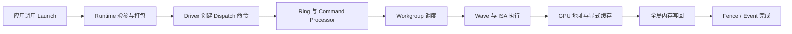
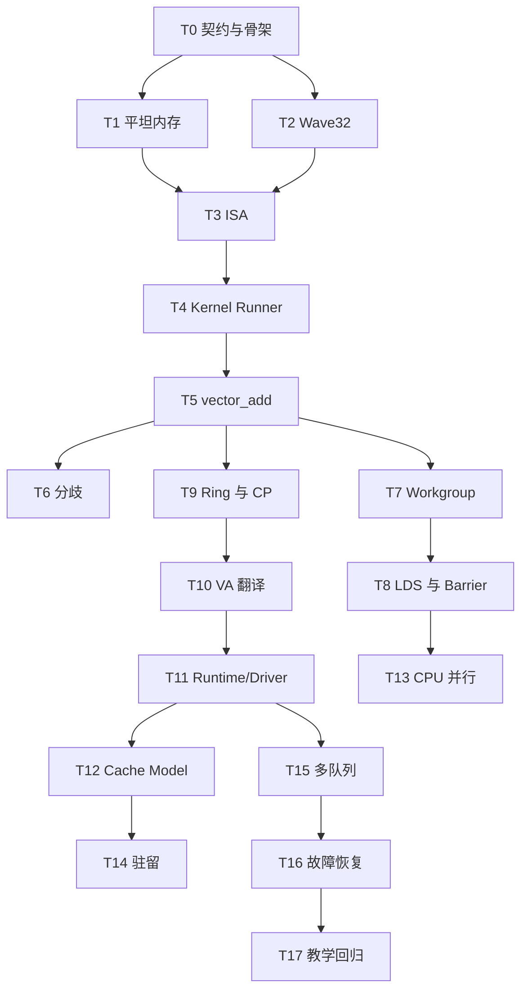

# CPU 模拟 GPU 教学项目：任务规划与实施规格

> 文档性质：项目级任务规划与验收规格。定义项目目标、分层边界、阶段划分、任务依赖、场景及完成条件；模块设计文档与实现任务应以本文的范围为准。
>
> 项目定位：在 CPU 上实现一个可追踪、可测试的 GPU 功能行为模拟器，用于学习 GPU 执行模型、驱动提交路径、内存层次和同步机制。它不是周期精确的 GPU 仿真器，也不承诺模拟特定厂商 GPU 的全部细节。
>
> 总原则：先让一个最小 kernel 端到端运行，再逐步加入并行、缓存、虚拟内存、异步队列和驱动抽象。每个阶段都有运行场景和明确 DoD；核心任务保持可独立验收，扩展功能不得阻塞基础教学闭环。

---

## 1. 项目目标与设计原则

### 1.1 项目回答的问题

项目以 CPU 实现 GPU 的功能行为，完整展示一次计算任务如何从应用 API 进入运行时和驱动、转化为命令、被命令处理器派发、映射为 workgroup/wave 执行、访问 GPU 地址空间与缓存、最终写回并通过同步对象通知完成。

首要成果是一个可单步跟踪的 `vector_add` 计算闭环。后续通过 reduction、histogram、分支、缓存和异步队列等场景逐渐揭示 GPU 的并行语义与软件栈结构。

### 1.2 明确边界

| 项目内 | 当前不做 |
|---|---|
| CPU 上的功能行为模型、确定性执行、可解释 trace | 周期精确、功耗、时钟、真实流水线每拍变化 |
| 简化的 GPU 地址空间、显式 L1/L2 cache model | 把宿主 CPU 的 L1/L2 直接当作被模拟的 GPU cache |
| 一种自定义精简 ISA 与手写/内置 kernel | 兼容 CUDA、HIP、MUSA 或完整 Vulkan/D3D12 API |
| 单进程 CPU worker 并行执行模拟 workgroup | 模拟真实 GPU 的硬件带宽、吞吐或占用率数值 |
| 可复现的功能测试和统计探针 | 以模拟器性能数据推断真实 GPU 性能 |

宿主 CPU 的 L1/L2/L3 只影响模拟器自身运行速度。模拟 GPU 的 L1/L2 必须由软件显式建模，定义容量、line size、命中/未命中、替换、写策略和一致性规则。两组缓存不可混为一谈。

### 1.3 教学设计原则

1. **端到端优先**：先完成一条最短可运行路径，不先实现所有模块的空壳。
2. **概念一次引入一个**：每个里程碑解决一个主要新概念，避免把调度、页表、缓存、异步和 API 兼容塞进同一任务。
3. **逐步替换简化模型**：早期采用 flat memory、单 wave、同步执行；后续明确替换点，不隐藏简化假设。
4. **模型与实现分开**：GPU 概念模型由显式状态和事件实现；CPU worker 只是模型执行策略。
5. **确定性优先**：功能结果不依赖线程调度、墙钟时间或未定义竞争顺序。
6. **每个任务有可运行验收**：DoD 包含输入、输出、断言或可检查 trace，不以“代码已写”作为完成标准。

---

## 2. 总体架构与数据通路

### 2.1 建议分层

| 层 | 主要职责 | 代表对象 |
|---|---|---|
| `common` | 稳定类型、错误、配置、packet/ABI、日志 | `GpuVa`、`Result`、`CommandPacket`、`DeviceConfig` |
| `runtime` | 用户可调用的设备、队列、内存、kernel 与同步接口 | `Device`、`Queue`、`Buffer`、`Kernel`、`Event` |
| `driver` | 验证请求、创建命令、管理上下文与提交 | `Context`、`CommandBuffer`、`Submission` |
| `firmware` | 模拟启动、doorbell、命令队列调度与完成通知 | `Ring`、`CommandProcessor`、`Fence` |
| `gpu_model` | GPU 行为模型的核心状态和执行单元 | `GpuDevice`、`ComputeUnit`、`Wave`、`MemorySystem` |
| `isa` | 指令编码/解码/执行及 kernel 镜像 | `Instruction`、`Program`、`Interpreter` |
| `tools` | 场景运行、参考结果、trace/统计与差分 | `scene_runner`、`trace_viewer`、`ref_model` |
| `apps` | 面向学习目标的示例和验收场景 | vector_add、branch、reduction、cache_probe |

依赖方向保持单向：

`common → gpu_model / isa → firmware → driver → runtime → apps`

`tools` 读取公开的输出、统计和 trace 格式；不得依赖 GPU 模型内部私有结构来推导期望结果。

### 2.2 核心计算通路

每一层都定义输入、输出、错误和可观测事件。最初允许 Runtime 到 GPU model 通过简化的同步接口连接；之后再逐步加入 Ring、doorbell 和异步队列，避免基础学习阶段被完整驱动样板阻塞。

---

## 3. 阶段总览

| 阶段 | 任务范围 | 学习结果 | 阶段出口 |
|---|---|---|---|
| A：最小计算闭环 | T0–T5 | CPU 解释执行一个 wave，完成 vector_add | 输入/输出正确、逐指令 trace 可复现 |
| B：SIMT 与 workgroup | T6–T8 | 理解 lane、分支、workgroup 协作与同步 | branch、reduction、histogram 通过判据 |
| C：驱动提交与地址空间 | T9–T11 | 理解 runtime→driver→queue→CP 和 VA 翻译 | 命令路径、映射、错误路径可追踪 |
| D：内存层次与并行执行 | T12–T14 | 理解 GPU cache、CPU 并行模拟和性能统计边界 | 串行/并行结果一致，cache 探针符合模型 |
| E：异步系统与教学收尾 | T15–T17 | 理解队列依赖、事件、恢复、扩展路线 | 端到端回归、文档和可复现实验齐备 |

阶段 A 是必须优先完成的可用产品；阶段 B–E 依赖前序契约，但可在边界稳定后按模块并行开发。章节/模块体量用 S/M/L 表示：S 为单一能力点，M 为完整小模块，L 为跨模块闭环，必须拆成子里程碑。

---

## 4. 任务规格

每项任务均按“目标—范围—依赖—实施项—交付物—DoD”验收。实现过程中新增功能若改变公开契约，必须同步更新接口文档、场景输入和回归判据。

### 阶段 A：最小计算闭环

#### T0：工程骨架与统一契约（S）

- **目标**：建立可编译、可测试、可配置的最小工程，并冻结跨模块基础类型。
- **范围**：构建、日志、错误返回、断言、设备配置、统一整数宽度；暂不建立完整驱动对象。
- **依赖**：无。
- **实施项**：
  1. 建立 `common`、`gpu_model`、`isa`、`apps`、`tools` 目录及依赖规则。
  2. 定义 `Result/ErrorCode`、`GpuVa`、`DeviceConfig`、日志级别和确定性随机种子。
  3. 提供命令行入口，支持选择场景、配置和 trace 开关。
- **交付物**：可构建骨架、契约头文件、最小自检场景、架构依赖说明。
- **DoD**：干净构建成功；自检验证基础类型和配置；错误码输出稳定；场景可重复运行。

#### T1：GPU 平坦内存与资源 API（M）

- **目标**：让 kernel 能通过 GPU 虚拟地址访问一块可追踪的模拟显存。
- **范围**：单一连续 GPU VA 空间、平坦字节数组、线性分配；无页表、无缓存。
- **依赖**：T0。
- **实施项**：
  1. 实现 GPU 内存分配/释放、边界检查、对齐策略。
  2. 实现 Host→GPU 上传、GPU→Host 读回和明确的资源生命周期。
  3. 提供 load/store 接口，统一记录地址、长度和访问来源。
- **交付物**：`GpuMemory`、`Buffer` 最小接口、越界和生命周期场景。
- **DoD**：上传后可读回；非法地址和越界访问返回确定错误；分配释放后审计无泄漏；访问 trace 显示 VA/长度/读写类型。

#### T2：Wave32 执行状态（M）

- **目标**：在 CPU 数据结构中表达 GPU 的一个 wave 与 32 个逻辑 lane。
- **范围**：wave32、lane 活跃掩码、标量/向量寄存器；先不处理分歧控制流。
- **依赖**：T0。
- **实施项**：
  1. 定义 wave、lane、SGPR/VGPR、PC、执行掩码等状态。
  2. 定义 lane id、work-item linear id 等内建值的来源与边界规则。
  3. 提供状态 dump，能查看每条指令前后的 PC、mask 和寄存器。
- **交付物**：Wave 状态模型、寄存器访问接口、状态 dump 示例。
- **DoD**：32 lane 的 mask 操作符合真值表；未激活 lane 不产生副作用；状态快照可稳定序列化。

#### T3：精简 ISA 与解释器（M）

- **目标**：用少量明确的指令实现可逐步调试的计算 kernel。
- **范围**：整数/浮点加法、乘法、比较、地址计算、load/store、分支、结束；不追求厂商 ISA 兼容。
- **依赖**：T1、T2。
- **实施项**：
  1. 设计指令语义表及定长或明确变长编码。
  2. 实现 decode、执行、PC 更新、访存异常传播。
  3. 提供手写汇编/字节码装载方式及反汇编输出。
  4. 定义浮点精度与异常处理策略，避免测试依赖未定义行为。
- **交付物**：ISA 规格、解释器、指令单测、最小汇编样例。
- **DoD**：每条指令有独立语义测试；编码/解码往返一致；trace 能解释每步输入、结果和副作用；非法 opcode 有明确错误。

#### T4：单 wave kernel 运行器（M）

- **目标**：把 kernel 镜像、参数、wave 状态和内存模型连接起来。
- **范围**：一个 kernel、一 wave、同步执行；通过 CPU 循环解释指令。
- **依赖**：T1–T3。
- **实施项**：
  1. 定义 kernel descriptor、参数布局和入口 PC。
  2. 初始化 wave 内建值和参数寄存器。
  3. 运行到 END、错误或指令步数上限；支持单步和连续模式。
- **交付物**：`KernelRunner`、kernel 参数 ABI、step/run 接口。
- **DoD**：至少一个逐 lane 计算 kernel 可运行；步数上限能终止死循环；单步与连续运行的最终状态相同。

#### T5：第一个端到端任务：vector_add（L，拆为 3 个子里程碑）

- **目标**：完成第一条从应用 API 到 GPU 内存写回的可观察路径。
- **范围**：N≤32 的单 wave vector_add；不要求 ring、编译器或并发 workgroup。
- **依赖**：T0–T4。
- **子里程碑**：
  - **T5.1**：应用准备输入/输出 buffer 和 kernel 参数。
  - **T5.2**：Runtime 调用同步 `launch`，驱动创建最简 dispatch descriptor。
  - **T5.3**：运行器执行 kernel，读回结果并与 CPU reference 比对。
- **交付物**：`scene_vector_add`、CPU reference、运行日志、完整数据通路说明。
- **DoD**：正常、空输入、非法参数和越界 case 均有判据；CPU reference 独立计算期望结果；重复运行输出一致。

### 阶段 B：SIMT 与 workgroup 协作

#### T6：控制流分歧与重收敛（M）

- **目标**：展示同一 wave 内 lane 执行不同分支时的 SIMT 语义。
- **范围**：条件分支、活动 mask 保存/恢复、结构化分支或明确的分歧栈方案。
- **依赖**：T5。
- **实施项**：定义分支语义；实现分歧/重收敛状态；记录 lane mask 变化；增加不同 lane 走不同路径的场景。
- **交付物**：分歧模型、branch kernel、逐步 trace。
- **DoD**：全真、全假、混合 mask 三类输入正确；无效 lane 不写内存；分支完成后活跃 lane 正确重收敛。

#### T7：多 wave / workgroup 与逻辑调度（L）

- **目标**：区分 work-item、wave、workgroup 与 CPU 执行线程。
- **范围**：多 wave 同步语义下的确定性串行调度；暂不以宿主线程代表 GPU wave。
- **依赖**：T5、T6。
- **实施项**：
  1. 定义 grid/block/workgroup 三维 ID、越界规则和线性化公式。
  2. 将 workgroup 拆分为若干 wave，并管理每个 wave 的寄存器和完成态。
  3. 提供可替换调度策略接口，初版 round-robin 串行执行。
- **交付物**：workgroup 模型、调度器、grid-stride 示例。
- **DoD**：多个 workgroup 的 ID/边界覆盖正确；调度顺序固定；改变调度顺序不改变无竞争 kernel 的结果。

#### T8：LDS、原子与 workgroup barrier（L）

- **目标**：建模 workgroup 内共享内存和跨 wave 协作的功能语义。
- **范围**：显式 LDS 数组、基本整数原子、workgroup barrier；不模拟真实 bank 冲突周期。
- **依赖**：T7。
- **实施项**：
  1. 定义 LDS 生命周期、地址范围和每 workgroup 隔离。
  2. 定义原子操作的线性化点与返回值。
  3. barrier 采用参与 wave 到齐后统一放行的逻辑事件；检测提前退出或不一致 barrier。
  4. 实现 reduction 或 histogram 场景。
- **交付物**：LDS/atomic/barrier 模块、协作 kernel、同步错误场景。
- **DoD**：共享数据结果正确；原子计数满足精确期望；barrier 不完整时报告可定位错误，不死锁挂起。

### 阶段 C：驱动提交与地址空间

#### T9：命令包、Ring 与 Command Processor（L）

- **目标**：用可观测的命令提交替代 Runtime 直接调用 KernelRunner。
- **范围**：单进程、单队列、CPU 同步推进的 Ring 模型；不模拟 MMIO 时序与中断延迟。
- **依赖**：T5；建议 T7 稳定后扩展 dispatch。
- **实施项**：
  1. 定义 packet header、opcode、长度、校验及版本规则。
  2. 实现 producer/consumer 指针、doorbell 事件与 Ring 回绕检查。
  3. Command Processor 解包并派发 CLEAR/COPY/DISPATCH/FENCE 等最小命令。
  4. 保留 direct-launch 对照入口，便于学习新旧路径差别。
- **交付物**：命令 ABI、Ring、CP、命令 trace。
- **DoD**：命令序列和执行效果可重放；非法包、Ring 满/空和截断包有稳定错误；通过 Ring 的 vector_add 与直连入口结果一致。

#### T10：Context、内存对象与 VA 翻译（M）

- **目标**：从平坦地址模型过渡到进程/上下文隔离的 GPU VA 模型。
- **范围**：软件页表 + TLB 功能模型；页大小固定；不模拟真实页表 walker 时延。
- **依赖**：T1、T9。
- **实施项**：创建 Context/ASID；映射、解除映射和权限检查；实现 VA→PA 翻译与可选 TLB 命中统计；定义未映射访问错误。
- **交付物**：地址空间管理器、页表/TLB 统计、隔离场景。
- **DoD**：不同 Context 的同 VA 指向不同数据；读写权限生效；TLB 开关不改变功能结果；失效后重新翻译正确。

#### T11：Runtime / Driver 对象边界与错误传播（M）

- **目标**：把场景代码从内部模型细节中解耦，形成教学所需的最小软件栈。
- **范围**：Device、Context、Buffer、Kernel、Queue、Submission 对象及错误映射；不做外部 API 兼容。
- **依赖**：T9、T10。
- **实施项**：明确对象生命周期；参数和命令合法性由 Driver 验证；定义 Runtime 错误、Driver 错误、GPU 执行错误的映射；禁止上层直接访问私有 GPU 模型状态。
- **交付物**：API/ABI 文档、对象模型、错误映射表、经抽象层运行的场景。
- **DoD**：所有核心场景经 Runtime→Driver→Ring→CP 路径执行；对象释放/重复提交/非法状态均有确定行为；层间依赖检查通过。

### 阶段 D：内存层次与 CPU 并行模拟

#### T12：显式 GPU L1/L2 Cache Model（L）

- **目标**：通过参数化的功能模型学习 GPU cache 行为和访问局部性。
- **范围**：可开关 L1/L2、固定 line size、LRU 等一种明确替换策略、write-through 或 write-back 选定一种；不仿真周期和真实吞吐。
- **依赖**：T10、T11。
- **实施项**：
  1. 定义缓存层级、容量、line size、关联度、替换和写策略配置。
  2. 定义 load/store 的命中、未命中、回填、脏行写回和 flush 行为。
  3. 定义一致性简化规则：初版仅有一个 GPU 执行域；Host 上传/读回通过显式同步和 invalidate/flush 完成。
  4. 统计请求次数、字节数、line fill、hit/miss、writeback、逻辑访问到物理模型传输的比例。
  5. 提供顺序、重复热点、随机访问三种 cache probe。
- **交付物**：Cache Model、配置文件、统计格式、cache probe 场景。
- **DoD**：开关 cache 不改变程序功能结果；容量/替换策略行为符合小规模手算用例；Host/GPU 同步边界可测试；统计定义写入文档。

#### T13：CPU Worker Pool 与确定性执行策略（L）

- **目标**：利用宿主 CPU 多核提高模型执行速度，同时保持模拟语义与并行度可控。
- **范围**：以 workgroup 为任务粒度的 worker pool；同一 workgroup 内 barrier 语义由模型调度器处理；不以宿主硬件缓存模拟 GPU cache。
- **依赖**：T7、T8、T11；缓存模块稳定后做集成回归。
- **实施项**：
  1. 实现 serial 与 parallel 两种执行模式及 worker 数配置。
  2. 规定可并行 workgroup 的条件、共享状态边界和结果汇合方式。
  3. 对有竞争或未定义次序的场景采用确定化规则或明确报告不支持。
  4. 测量模拟器自身 CPU 时间，仅作为 host 实现性能指标单独报告。
- **交付物**：WorkerPool、执行模式配置、并行一致性场景、host 性能报告格式。
- **DoD**：serial/parallel 对无竞争场景输出一致；stress 场景无数据竞争；宿主缓存优化和 GPU cache 统计分开报告；性能数字不被解释为 GPU 性能。

#### T14：驻留、资源预算与可观测性（M）

- **目标**：用简化模型展示显存预算、资源驻留和内存压力。
- **范围**：显式 resident/non-resident 状态、固定预算、确定性逐出策略；不实现复杂共享虚拟内存或真实缺页恢复。
- **依赖**：T10、T12。
- **实施项**：资源驻留/退出；超预算处理；访问非驻留资源时的错误或受控恢复策略；输出 residency、翻译、缓存的关联 trace。
- **交付物**：Residency Manager、资源压力场景、内存事件 trace。
- **DoD**：预算内访问成功；超预算按配置给出稳定结果；逐出和重新驻留有明确数据正确性规则；trace 可关联资源 ID、VA 和缓存事件。

### 阶段 E：异步系统与教学收尾

#### T15：多队列、Fence/Event 与依赖图（L）

- **目标**：展示异步提交及跨队列依赖，而不引入墙钟驱动的模拟行为。
- **范围**：Compute/Copy 两种逻辑队列、逻辑时间线 fence、event wait；同步推进的确定性事件循环优先。
- **依赖**：T9、T11。
- **实施项**：队列提交序号；signal/wait；资源跨队列使用依赖；可选 copy 与 compute 交错；死锁/循环依赖检测。
- **交付物**：多队列事件调度器、依赖 trace、async copy + kernel 场景。
- **DoD**：依赖未满足时消费者不执行；signal 前不得观察到写入完成；改变无依赖命令的队列顺序不破坏结果；循环依赖可诊断。

#### T16：故障注入、超时与可恢复性（M）

- **目标**：让学习者观察执行错误如何跨 GPU model、CP、Driver 和 Runtime 传播。
- **范围**：非法指令、非法地址、Ring 错误、执行步数超限等软件可控故障；不模拟真实硬件故障概率。
- **依赖**：T9–T11、T15。
- **实施项**：故障注入开关；错误定位和责任层；Context/Queue 失效状态；简单 reset/recreate；保留失败现场快照。
- **交付物**：错误场景集、错误传播表、故障快照。
- **DoD**：故障能被对应层捕获并映射；失败队列不误报成功；复位后新任务可运行；诊断信息包含场景、命令、PC/VA 等有效上下文。

#### T17：教学场景、回归套件与扩展入口（M）

- **目标**：把模块实现组织成循序渐进的实验，而非堆叠孤立功能。
- **范围**：基础场景必须 headless 可运行；图形 API、复杂 ISA 和 Vulkan/MUSA/HIP 兼容为后续选修。
- **依赖**：T0–T16 中纳入一期的任务。
- **实施项**：
  1. 为每个概念提供一个最小 scene、预期结果、关键 trace 说明和常见错误。
  2. 建立自动场景 runner、CPU reference、差分输出和回归汇总。
  3. 文档列出模块目标、输入输出、依赖、算法简化、DoD、扩展点。
  4. 提供学习路径：先运行、再单步、再修改参数/实现、最后比较统计。
- **交付物**：场景目录、教学说明、回归报告、扩展路线图。
- **DoD**：核心场景一条命令可运行；新手可从 vector_add 顺序推进至 cache/async 场景；每个场景失败都产生足够诊断材料；未实现能力明确报告“不支持”。

---

## 5. 任务依赖与推荐实施顺序

### 5.1 主依赖

### 5.2 建议顺序

1. 串行完成 T0–T5，确保最小计算闭环尽早可用。
2. 完成 T6–T8，先建立正确的 SIMT/workgroup 语义，再引入 CPU 并行。
3. 实施 T9–T11，把直连 runner 逐步升级为教学版驱动提交链路。
4. 实施 T12–T14，先固定显式 GPU cache 语义，再优化 host worker 执行。
5. 实施 T15–T17，完成依赖调度、故障解释和课程化材料。

模块接口稳定后，可并行编写 ISA 工具、参考模型、trace viewer、场景文档；不得并行改动同一公共 ABI 而不先裁决契约。

---

## 6. 验收场景集

| 场景 | 验证目标 | 主要任务 | 核心判据 |
|---|---|---|---|
| A0 `contract_smoke` | 类型/配置/错误 | T0 | 自检通过、错误格式稳定 |
| A1 `memory_copy` | 上传、寻址、读回、越界 | T1 | 原始字节一致、边界错误正确 |
| A2 `isa_step` | 指令语义与单步 | T2–T4 | 状态快照与手算期望一致 |
| A3 `vector_add` | 第一个端到端 dispatch | T5 | N 范围内逐元素相等、重复结果一致 |
| B1 `branch_mask` | lane 分歧及重收敛 | T6 | 混合分支输出正确、mask trace 正确 |
| B2 `multi_workgroup` | grid/block/wave 映射 | T7 | 各工作项唯一覆盖、尾部边界正确 |
| B3 `reduction_histogram` | LDS、原子、barrier | T8 | 结果符合 CPU reference，无死锁 |
| C1 `ring_dispatch` | Runtime 到 CP 的提交 | T9–T11 | ring/direct 两入口语义等价 |
| D1 `cache_locality` | 显式 L1/L2 命中行为 | T12 | 统计符合访问序列的解析期望 |
| D2 `serial_parallel` | CPU worker 并行实现 | T13 | 输出一致、无竞争错误 |
| D3 `residency_pressure` | 预算/驻留/逐出 | T14 | 事件和访问结果符合配置 |
| E1 `async_copy_compute` | 队列依赖与事件 | T15 | 消费者严格等待生产者完成 |
| E2 `fault_recovery` | 故障传播和恢复 | T16 | 故障被定位、reset 后任务可运行 |

每个场景具有固定输入和配置；统计量用于解释模型行为，功能输出由独立 CPU reference 或解析期望判定。墙钟耗时只用于报告 host 模拟器实现效率，不作为 GPU 行为正确性判据。

---

## 7. 横向设计约束

### 7.1 地址、内存和同步

- `GpuVa` 与宿主指针使用不同类型，禁止隐式混用。
- Host 上传、GPU 执行和 Host 读回之间通过明确 API / event 建立可见性。
- 初始 flat memory 是简化实现；页表、TLB、cache、驻留每阶段替换单一职责，不改变上层 kernel 的逻辑地址语义。
- Cache model 的统计只统计被模拟的 GPU 请求；宿主 CPU cache miss 不进入 GPU cache 报表。

### 7.2 执行确定性

- 所有功能状态依赖显式配置、输入和逻辑事件，不依赖 `steady_clock`。
- serial 模式作为语义基线；parallel 模式只并发执行已声明相互独立的 workgroup。
- 对数据竞争、未定义内存序或不支持的 barrier 模式，检测并报告，不以随机结果伪装真实硬件行为。

### 7.3 可观测性

- Trace 事件至少带场景 ID、逻辑序号、模块、对象 ID、地址/长度或 wave/workgroup 标识。
- 不要求所有模块输出冗长日志；提供结构化事件和按模块开关。
- 每个场景失败时输出配置快照、错误上下文、关键 trace 和期望/实际差异。

### 7.4 性能表述

项目评估分成两类，禁止混写：

1. **模型行为统计**：GPU 请求数、cache hit/miss、命令数、逻辑访存字节数等，是对所定义模型的统计。
2. **模拟器运行效率**：宿主 CPU 时间、worker 数、host 内存占用等，是软件实现指标。

本项目不根据 CPU 模拟耗时推断真实 GPU 的吞吐、时延、占用率或带宽。

---

## 8. 功能范围与优先级

| 级别 | 纳入内容 | 处理方式 |
|---|---|---|
| P0 必须 | T0–T5，T7 的最小 workgroup 支持，T9 的精简 Ring/CP，T17 的核心回归 | 构成教学版计算 GPU 最小系统 |
| P1 一期增强 | 分歧、LDS/原子/barrier、VA/TLB、L1/L2、CPU worker、多队列、错误恢复 | 按依赖推进，模块分别验收 |
| P2 选修扩展 | 简化图形管线、shader compiler、复杂 cache coherence、页错误恢复、API 前端 | 作为独立实验或后续课程，不进入一期完成门槛 |
| 范围外 | 周期精确仿真、真实驱动/固件、厂商 ISA/API 全兼容、硬件性能预测 | 不纳入项目目标 |

图形线可以作为后续教学扩展，但不应与计算主线争夺一期资源。若新增图形模块，应复用命令、内存、ISA、队列、同步与校验底座，并单独定义 scope 和验收场景。

---

## 9. 项目完成门禁

### 阶段 A 门禁：最小闭环

- T0–T5 的 DoD 全部通过。
- vector_add 可以从应用入口启动，经过 Runtime/最小 Driver 语义，运行 ISA 并写回 GPU memory。
- 同一输入重复运行产生相同结果；逐指令模式能追踪 lane 状态和访存。

### 阶段 B/C 门禁：执行语义与提交链

- branch、multi_workgroup、reduction/histogram 通过参考判定。
- Ring/CP 路径和 direct-launch 基线语义一致。
- Context/VA 错误能经 Driver/Runtime 传播并保留诊断信息。

### 阶段 D/E 门禁：系统机制

- L1/L2 开关和参数改变模型统计，但不改变无数据竞争场景的功能结果。
- serial/parallel 对照回归通过；多队列依赖满足 happens-before。
- 故障场景可定位；恢复后回归场景可运行。
- 场景、文档、配置和统计定义足以让学习者复现实验。

项目整体完成的标准不是模块数量，而是每一项已纳入范围的能力都具有明确语义、可执行样例和可验证边界。

---

## 10. 文档与任务拆分规则

每个模块设计文档采用统一结构：

1. 目标、概念和本模块不负责的内容；
2. 前置条件、依赖接口和所属阶段；
3. 数据结构/状态机/算法及关键决策；
4. 输入输出、错误和跨模块契约；
5. 分步任务与可交付文件；
6. 场景、测试输入和 DoD；
7. trace/统计字段；
8. 简化假设、限制和后续替换点；
9. 参考来源、精确版本/提交、借鉴点及未采用部分。

满足以下任一条件时应拆分任务：跨越两个以上独立概念；同时修改三个以上主要模块；DoD 需要多个互不相关场景；单任务难以在一个短开发周期内完成并评审。拆分后保留父任务目标与整体门禁，避免子任务各自完成但端到端链路未完成。

---

## 11. 推荐的下一步文档产出顺序

1. `project-charter.md`：冻结定位、范围、非目标和术语。
2. `architecture.md`：冻结层次、依赖方向、对象生命周期和主数据通路。
3. `contracts.md`：定义地址、错误、命令、kernel 参数、事件与 trace ABI。
4. `tasks/T0–T5`：优先写到足以直接开工并完成 vector_add。
5. `scenes/A0–A3`：先固定最小回归与参考模型。
6. 建立 reference-map.md，登记开源源码、规范和架构资料的版本及任务映射。
7. 后续按 T6–T17 逐个补齐模块设计和场景规格；每次新增前检查依赖与范围。

此顺序先把可运行闭环和公共契约落地，再扩展硬件模型；避免先把大量设计章节写完、最后才发现模块无法组成一致的端到端系统。

---

## 12. 与原设计资料的关系

本文是面向“CPU 模拟 GPU 教学项目”的重新规划，不是对原 Stage 1/2/3 章节编号的逐章改写。原有内容中可复用的概念包括命令处理、内存管理、SIMT/ISA、缓存、workgroup 协作、队列同步和错误恢复；完整图形 API、厂商风格 UMD、复杂编译器与几何管线暂作为扩展方向。

原设计资料仍保留为历史基线，便于回查原章节与模块映射；当新任务规划与旧总览的章节顺序不同时，以本文件的新任务依赖和阶段门禁为实施依据。对原仓库已有设计文档的修改应另行形成变更记录，避免把“重新规划”误认为仓库内容已经同步更新。

---

## 13. 参考实现与资料来源

本项目借鉴已有 GPU 软件栈和公开架构资料来确定模块边界、对象生命周期、命令流、内存管理和同步语义。参考实现用于学习和交叉验证，不要求复制其代码，也不把任何一家厂商的实现当成唯一标准。项目自身的接口、简化假设和 DoD 仍由本文及后续模块设计文档定义。

### 13.1 参考层次与用途

| 参考类别 | 主要来源 | 重点观察内容 | 对本项目的用途与边界 |
|---|---|---|---|
| 图形用户态驱动 | [Mesa 源码树](https://gitlab.freedesktop.org/mesa/mesa)、[Mesa 源码目录说明](https://docs.mesa3d.org/sourcetree.html)、[RADV 文档](https://docs.mesa3d.org/drivers/radv.html) | Gallium 驱动分层、Vulkan API 到硬件接口的映射、资源/管线对象、命令构建、shader 编译、驱动测试 | 图形扩展和未来 UMD/HLI 设计的主要源码参考。Mesa 主要提供用户态驱动和编译器代码；不能据此推断未公开的 GPU 硬件内部实现，也不能把 Mesa 驱动直接等同于 KMD。 |
| MUSA 计算软件栈 | [MUSA 开发者文档](https://developer.mthreads.com/musa)、[MooreThreads/torch_musa](https://github.com/MooreThreads/torch_musa)、[MooreThreads/tutorial_on_musa](https://github.com/MooreThreads/tutorial_on_musa) | Device/Context/Stream/Event 使用方式、内存与 kernel 调用接口、框架后端接入、扩展构建和测试组织 | 计算 Runtime/驱动适配层及教学示例的重要参考。公开仓库可以观察到的接口和框架集成，不能代表完整 MUSA 内核驱动、固件或编译器内部均已开源；未公开部分标记为未知，不按猜测补齐。 |
| AMD 架构与计算栈 | [ROCm/HIP 文档](https://rocm.docs.amd.com/projects/HIP/en/latest/)、[HIP 硬件实现说明](https://rocm.docs.amd.com/projects/HIP/en/latest/understand/hardware_implementation.html)、[ROCm/amdgpu](https://github.com/ROCm/amdgpu)、[LLVM AMDGPU 使用文档](https://llvm.org/docs/AMDGPUUsage.html) | CU/wave/workgroup 的公开模型、内存与同步、命令/地址空间接口、驱动分层和 ISA 工具链 | 用于交叉检查 T2–T3、T6–T15 中的执行、内存、队列及驱动抽象。AMD 文档中的具体代际行为和数值不直接推广为通用 GPU 规则。 |
| NVIDIA 架构与计算栈 | [CUDA Programming Guide](https://docs.nvidia.com/cuda/cuda-programming-guide/)、[PTX ISA](https://docs.nvidia.com/cuda/parallel-thread-execution/)、[NVIDIA/open-gpu-kernel-modules](https://github.com/NVIDIA/open-gpu-kernel-modules) | CUDA 设备/执行模型、PTX 虚拟 ISA、内存/同步语义、公开的 Linux 内核模块边界 | 用于与 AMD/MUSA 资料交叉检查通用概念和厂商差异。NVIDIA 开源内核模块并不等于完整用户态驱动和 GPU 硬件实现；PTX 也不是实际硬件机器码。 |
| 行业规范与通用系统接口 | [Khronos Vulkan 规范](https://registry.khronos.org/vulkan/specs/)、[Linux DRM 文档](https://docs.kernel.org/gpu/)、[SPIR-V 规范](https://registry.khronos.org/SPIR-V/) | 显式资源、命令缓冲、队列、同步、对象生命周期、内核图形子系统接口 | 用于检查 API 契约、同步和分层设计是否自洽；规范规定可观察行为，不规定特定 GPU 内部如何实现。后续可纳入 OpenCL、其他开源驱动和学术/工业系统设计。 |

### 13.2 参考来源到任务的映射

| 任务/模块 | 建议参考 | 需要提取的设计问题 |
|---|---|---|
| T0、T11：公共契约与 Runtime/Driver 边界 | Vulkan、MUSA SDK/torch_musa、Mesa Gallium/RADV | 公共对象如何创建/销毁；验证由哪层承担；错误如何映射；API 与硬件命令如何解耦 |
| T1、T10、T12、T14：地址、缓存与驻留 | AMDGPU/ROCm、NVIDIA 公共文档与开放内核模块、Mesa winsys | VA/资源句柄、页映射与权限、可见性/flush 语义、缓存模型边界；哪些信息属于公开接口，哪些属于硬件细节 |
| T2–T8：Wave、ISA 与协作 | HIP 硬件说明、CUDA Programming Guide/PTX、LLVM AMDGPU、MUSA 教程 | lane/wave/workgroup 语义、控制流、参数和寄存器、barrier/atomic 作用域；跨厂商相同概念与不同定义 |
| T9、T15、T16：提交、队列与恢复 | Mesa 驱动提交路径、MUSA stream/event 接口、Vulkan 队列/同步、Linux DRM | 命令从用户态到内核态的职责边界；队列依赖表达；逻辑完成与错误恢复的传播路径 |
| 图形选修线 | Mesa Gallium、RADV、RadeonSI、Vulkan 规范 | API 前端、状态追踪、管线创建、shader 编译、资源绑定与命令提交如何分层 |
| T17：场景与回归 | Mesa 测试体系、torch_musa tests/examples、Vulkan CTS（可选） | 如何构造最小复现、能力判定和回归；如何让教学测试不依赖厂商硬件 |

### 13.3 参考和裁决规则

1. **先看规范，再看实现**：API/ISA 语义优先引用正式规范或官方编程文档；源码用于解释一种实现路径，不单独作为跨厂商语义依据。
2. **分清抽象层次**：每条参考资料标注为 API/Runtime、UMD、KMD、Firmware、ISA、硬件架构或测试工具；不得把某层的职责误写到另一层。
3. **多源交叉验证**：通用模块尽量至少比较两个不同生态；仅单一厂商公开的能力应标注“厂商特定”，并说明是否纳入本项目。
4. **公开信息与推断分开**：设计记录区分“规范明确规定”“源码可观察”“跨来源归纳”“教学模型选择”“尚未验证假设”。对闭源硬件/驱动部分不得用推测填补事实空白。
5. **每项借鉴都要解释取舍**：记录参考文件/符号/目录、精确版本或 commit、借鉴的思想、为教学模型所做的简化，以及明确不采用的实现细节。
6. **跟踪版本和许可**：源码引用固定到 tag/commit 或访问日期；本项目只记录和借鉴设计，不复制受许可证约束的代码。若确需复用代码，先单独核查许可证兼容性并记录来源。
7. **允许扩展资料池**：后续补充的开源项目、规范、论文或业界设计纳入 reference-map.md，按上述分类和裁决规则评估，不因来源不在本节初始名单而排除。

参考链接会随上游仓库和文档更新。每个具体模块设计文档提交时，应记录其实际查阅的版本/commit 和日期；本节的链接是入口清单，不视作冻结版本或对所有链接内容的永久背书。
